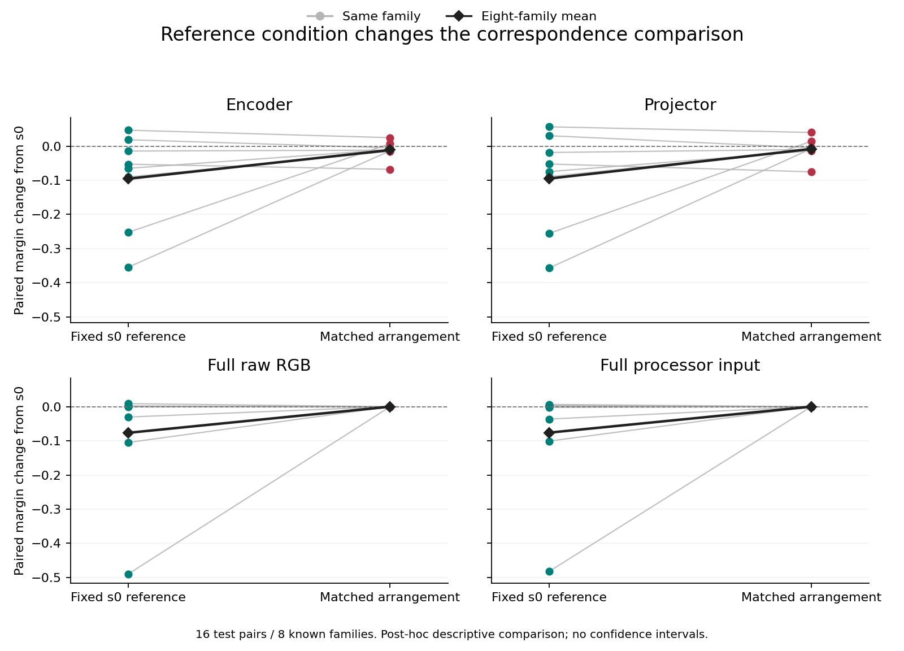

# Auditing Fixed Reference Correspondence under Matched Input Rearrangements in a Vision Language Model

Working manuscript, 2026-11-09. Methods and existing Results draft; not a
submission-ready paper. Note 0093 is the primary development measurement;
Notes 0094 and 0098 are separately identified post-hoc follow-ups. The abstract,
related work, final discussion and untouched confirmation remain open. See
the [claim and figure map](../research_notes/0095_manuscript_and_reference_audit_preparation.md).

## Introduction

An image-conditioned change in internal tensors does not by itself identify
a semantic effect. Correspondence can already exist in input coordinates,
and measured differences can depend on preprocessing, execution path or
reference condition. We ask a narrower question: does correspondence to
fixed known-family references remain unchanged under a controlled
rearrangement that preserves a registered set of input statistics?

We combine audited input construction with full-vector encoder and projector
observations in FastVLM. A crossed spatial/palette quartet defines factorial
interaction vectors. Guarded-tile rearrangements preserve twelve specified
feature views at raw and processor input starts. References are sealed
before test-source generation; low-amplitude directions remain unavailable.

Matched feature views coexist with changed full visual interaction directions
and fixed-reference margins in this development cohort. Six of eight known
families have negative margin changes at both sites; two have positive
changes. This separates the visual representations from the twelve tested
views under this construction, not from every possible input feature. It
does not establish learning-specific effects, semantic steering or
information loss.

A separately registered post-hoc crossing shows that reference condition
substantially changes this reading. Matching reference and test arrangements
reduces the mean visual-site decline, while full-input changes become
numerical-scale. Family exceptions remain. We therefore distinguish fixed
reference mismatch from transformation-conditioned correspondence rather
than interpreting either as a general measure of information loss.

## Methods

### Cohort and controlled inputs

Eight ordered generator-pairing families comprise four geometric and four
stochastic families. Each contributes two reference source pairs (r5/r6)
and two test source pairs (r7/r8): 32 source pairs and 64 source images.
Test sources are new seeds of known families, not held-out families or
evidence of pretraining novelty.

Each source pair produces four spatial/palette cells, MM, MJ, JM and JJ,
under four arrangements s0 through s3. M and J denote the first and second
donors within an ordered family, not Mandelbrot and Julia membership in
this cohort. The payload-first construction uses a fixed gray canvas and
guarded tiles. Maps rearrange 6,912 of 76,800 content pixels, or 9% of
content support, not the whole scene. Raw candidates have shape
320 x 320 x 3; processor tensors have shape 1 x 3 x 1024 x 1024.

Twelve fixed input views comprise global moments, grid means, small-pool
means and energies, and large-pool means and energies, at both raw RGB
and processor starts. Feature matching uses absolute tolerance 1e-10 and
relative tolerance zero. Joint-word multiset and candidate palette checks
accompany these comparisons. These audits do not exhaust input information.
The [registered source design](../../configs/stat_matched_source_panel_v1.json)
and [acquisition registration](../research_notes/0091_stat_matched_source_acquisition_registration.md)
specify the construction and execution budget.

### Full visual observations and execution qualification

The model is `mlx-community/FastVLM-0.5B-bf16`. The primary sites are
the full encoder output, shape 1 x 256 x 3072,
and projector output, shape 1 x 256 x 896. The observation path was
[qualified separately](../research_notes/0068_representation_observation_calibration.md).
Selected cache tensors are audit artifacts, not additional primary endpoints
in this matched-input panel. Historical replay, synthetic processor cases,
zero/constant shams and a mandatory nonmatching sentinel bound the path.

The run used 665 processor-only calls and 920 model source contexts:
384 historical, 24 sham and 512 experimental contexts. Its 2,760 decoder
calls are a distinct count. All 256 reference cells and their artifacts
were sealed at context 664 before test-source generation; the first test
context was 665. No reference or condition was selected using test scores.

### Interaction directions and fixed-reference margins

Cell vectors are flattened in C order and converted to float64 before
computing the interaction and reference directions:

```
z = (JJ - MJ) - (JM - MM)
unit(z) = z / ||z||
reference(f) = unit(unit(z[f,r5,s0]) + unit(z[f,r6,s0]))
margin(p,s) = cosine(z[p,s], reference(own family))
              - mean cosine to the other three same-class references
D(p) = mean(margin(p,1), margin(p,2), margin(p,3)) - margin(p,0)
```

The primary endpoint averages D over two test pairs within each family,
then equally over all eight families. The reference condition stays s0 for
every test arrangement. Negative D means reduced relative known-family
correspondence to those fixed references, not absolute representational
distance or disappearance of all correspondence.

Learned directions require interaction norm greater than 1e-6 times the
sum of four cell norms. Sensitivity floors are 1e-8 and 1e-4. Baseline
views use the norm guard 100 * 4 * 1e-10 * sqrt(d), for feature dimension d.
Both reference replicates are required; their summed unit directions must
have norm greater than 1e-12. Exact-zero directions are unavailable.
Missing required margins make the fixed-denominator aggregate unavailable;
there is no complete-case filtering or zero imputation.

The dependency unit is a source pair within a known family. Cells, shifts,
floors and sites are repeated measurements, not independent samples.
No p-values, confidence intervals or statistical equivalence tests were
registered for this development panel.

### Post-hoc score accounting

After the primary outcomes were known, a separate saved-score-only plan
decomposed D as delta_own minus delta_other, with each delta defined as
the mean over s1/s2/s3 minus s0. Both signed terms and the unchanged source
D are retained. An independent exact-rational oracle checks arithmetic over
stored binary64 values. This is algebraic accounting, not a new experiment,
pre-outcome preregistration or causal attribution. The plan and results are
in [Note 0094](../research_notes/0094_margin_decomposition.md).

### Post-hoc reference crossings and full input comparators

After Notes 0093-0094 were known, a separate plan fixed all 4 x 4 reference
and test arrangement crossings on the two visual sites and full raw/native
input vectors. All four views use the same three scale-relative amplitude
floors, with 1e-6 primary, rather than transferring the twelve feature views'
matching-error bound to full inputs. Raw uint8 converts directly to float64;
native float32 converts without reprocessing; visual bfloat16 words are
expanded before conversion. Coordinate order remains unchanged.

For each reference arrangement a, r[f,a] is the normalized sum of unit r5/r6
interaction directions. Let m[p,a,b] compare the test direction at b with
these own and other same-class references. Fixed change averages m[p,0,b]
over b=1/2/3 minus m[p,0,0]; matched change uses m[p,b,b] instead. Their
difference averages m[p,b,b]-m[p,0,b]. Both references must be available,
and the original cancellation and fixed-denominator rules remain in force.
Every crossing and all families are retained, without alignment fitting.
The original learned s0 rows must reproduce before accepting new results.
[Notes 0096-0098](../research_notes/0098_reference_crossing_results.md) retain
the post-hoc plan, execution release and native-content verification.

## Results

### Specified input gates pass

All 4,608 matched feature comparisons pass; maximum residual is
3.4638958368304884e-14. All 6,144 feature/oracle comparisons pass; maximum
error is 3.0253577421035516e-14. All 49,920 full/per-pool raw/native joint-word
comparisons and 256 candidate raw palette checks are exact. Candidate
palette preservation does not imply complete original-donor preservation.

Eleven available baseline profiles have paired changes on the numerical
scale, with maximum absolute D 1.628829449790148e-14. The raw global-moment
profile has 0/16 available test pairs and remains unavailable, not zero.
Numerical matching is not a statistical equivalence result.

### Full visual fixed-reference correspondence changes

| Site | Identity margin | Mean nonidentity margin | Paired change D |
| --- | ---: | ---: | ---: |
| Encoder | 0.222122 | 0.126465 | -0.095657 |
| Projector | 0.224646 | 0.129592 | -0.095054 |

Exact D values are -0.09565712588343249 and -0.09505422162164956.
All 16/16 test pairs are available at both sites. All three learned floors
yield identical availability and primary scores; these are sensitivity
checks, not replications. Average margins remain positive after rearrangement.

Mean s0-versus-nonidentity interaction-direction cosines over 48 repeated
pair/shift comparisons are 0.182170 and 0.179556 at encoder and projector.
Norm ratios range from 0.947668 to 1.097644 and from 0.947426 to 1.099038.
Directional changes coexist with broadly retained interaction lengths.
These are factorial interaction vectors, not individual-cell activations
or evidence of a shared rotation.

### All family differences are retained

| Known pairing family | Encoder D | Projector D |
| --- | ---: | ---: |
| Voronoi / quasicrystal | -0.065158 | -0.074642 |
| Checkerboard / hex tiling | -0.354761 | -0.356681 |
| Square / triangle tiling | -0.252540 | -0.255467 |
| Voronoi / hex tiling | -0.090559 | -0.089357 |
| White / blue noise | -0.052967 | -0.052408 |
| White noise / random dots | +0.018599 | +0.030406 |
| Blue noise / random dots | -0.014497 | -0.018708 |
| Sparse / dense dots | +0.046626 | +0.056425 |

Six of eight families have negative D at each site; two have positive D.
At pair level, 12/16 encoder and 11/16 projector changes are negative.
No opposite-sign family is omitted or used to choose a replacement cohort.

### Post-hoc own and other agreement accounting

| Site | Change in own cosine | Minus change in other cosine |
| --- | ---: | ---: |
| Encoder | -0.104124 | +0.008467 |
| Projector | -0.102939 | +0.007884 |

In the overall average, own-family agreement declines while other-family
agreement also declines, partly offsetting the margin loss. This is not
an average increased-other-agreement pattern. The two positive-D families
have different signed-component patterns, retained in Note 0094. No
percentage or mechanistic attribution is inferred from this accounting.

### Matched reference conditions change the comparison

| Full view | Fixed-reference change | Matched-reference change | Reference difference |
| --- | ---: | ---: | ---: |
| Encoder | -0.095657 | -0.011530 | +0.084128 |
| Projector | -0.095054 | -0.008381 | +0.086674 |
| Raw RGB | -0.076563 | -2.639e-18 | +0.076563 |
| Processor input | -0.075960 | -6.966e-18 | +0.075960 |

All 16/16 test pairs remain available at every site and floor. Mean changes
at the visual sites become much smaller with matched references. Full input
vectors also show negative fixed-reference changes, but matched-reference
test-pair changes have maximum absolute values 1.1102230246251565e-16 and
8.326672684688674e-17 at raw/native starts. Numerical-scale input changes
are not statistical equivalence evidence.

The visual-site average is not uniform family recovery. White/blue noise
becomes more negative with matched references: -0.067953 at encoder and
-0.075351 at projector. Square/triangle changes from negative to positive,
while white-noise/random-dots changes from positive to negative. Both sites
have six negative and two positive matched family changes, with membership
different from the fixed-reference case. No exception is removed.



Thin lines connect each known family and black diamonds show the equal-family
mean. The complete score matrices retain every arrangement crossing, not only
the fixed row and matched diagonal shown here. Repeated sites, arrangements
and floors are not independent samples.

## Verification and availability

Two fresh file-only verifications check 27,838 receipted files, including
24,794 binary artifacts, and produce byte-identical trees. They do not
independently rerun inference. Public profiles permit reconstruction of
published scores, aggregates and missingness. Full raw/native inputs,
packed visual tensors, selected cache tensors and original sidecars remain
local; full native-word reverification requires those artifacts.

The [primary summary](../../examples/research_notes/0093_stat_matched_source_results/summary.json),
[profiles](../../examples/research_notes/0093_stat_matched_source_results/profiles.jsonl),
[receipts](../../examples/research_notes/0093_stat_matched_source_results/verification_receipts.json)
and [post-hoc summary](../../examples/research_notes/0094_margin_decomposition/summary.json)
retain exact values and provenance. Acquisition used implementation commit
45ad7db162194ebe7cb596526ec1953605af6700 and capture SHA256
fd2ac478506f69c1320fed7a26a9af02e2e3bf251b76fb14bacb2334a30e67e9.

The crossing follow-up used committed implementation
158afa56f8fde01320c23fe867dda7bb8b934da4. Two fresh verifications independently
load native arrays and reconstruct directions, references and scores with
different score reductions; norm-library arithmetic is shared. Their complete
trees are byte-identical. The maximum production/oracle difference is
3.219646771412954e-15 under the fixed absolute 1e-12 check. The
[crossed profiles and receipts](../../examples/research_notes/0098_reference_crossing_results/summary.json)
are portable; full native inputs remain local. New model/processor calls are zero.

## Interpretation and remaining limits

The separation concerns twelve fixed views, registered guarded-tile support,
two full visual sites and known-family development data. Fixed-s0 reference
mismatch is not equivalent to loss of family information. The post-hoc
crossing and full-input comparators show why: fixed-reference change occurs
already at input starts, and matching references sharply reduces the mean
visual-site change. Residual family-dependent visual changes remain, unlike
the numerical-scale matched input changes. These comparisons do not identify
a common rotation or a training-specific cause.

The twelve matched views do not constrain every input statistic. Descriptive
raw/native spectra can still vary across arrangements, as retained in
Note 0093; neither spectral causation nor a frequency-only explanation is
identified by the present comparison.

No untouched confirmation cohort has been generated or sealed. The study
does not identify learning specificity, semantic steering, cache-to-answer
mediation, arbitrary-transform invariance or unseen-family transfer. Earlier
prompt/readout controls use separate cohorts and remain supporting protocol
evidence, not a causal bridge from these vectors to answers. Model-general
claims, trained/untrained comparisons and causal interventions require
separately bounded studies.
