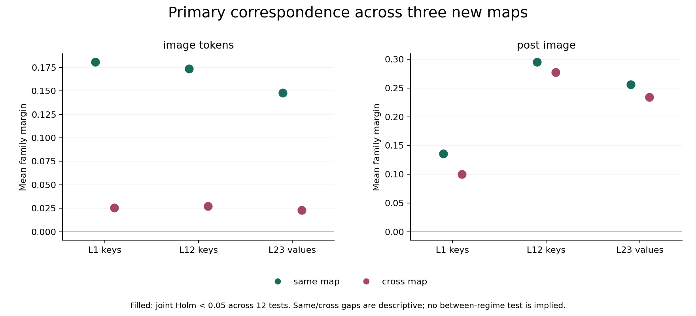
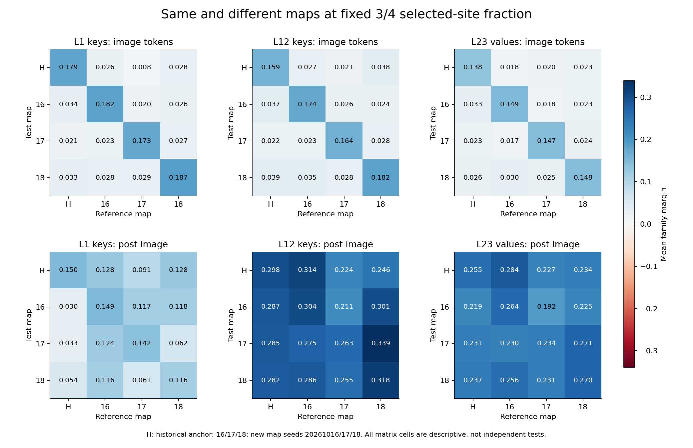

# Research Note 0049: Fixed-Fraction Map-Seed Transfer

Date: 2026-10-16

Status: input and cache studies completed; independent publication checks passed.

## Main Result

At a fixed 3/4 selected-site fraction, pairing correspondence is not confined
to one shared permutation map. All twelve registered aggregate tests pass
joint Holm correction (`p=0.020833` or `0.034722`), including all six cross-map
tests. The size of the correspondence margin nevertheless depends strongly
on the token region:

- In image positions, cross-map mean margins are only 14.1%-15.7% of same-map
  margins at the three fixed targets.
- In post-image positions, the corresponding ratios are 73.4% at L1 keys,
  94.1% at L12 keys and 91.5% at L23 values.
- Comparable interaction-vector lengths do not imply equal vectors: across
  new maps, paired image cosine medians are 0.066-0.076, versus 0.404 and 0.376
  in post-image L12/L23.

This supports **cross-map known-pairing correspondence under this fixed
transformation recipe**, not a universal invariant direction. The margin
ratios are descriptive, not retained semantic information or tests of a
same-versus-cross difference. Eight of 96 primary family-view margins are
negative and remain in the record.

Following [Note 0048](0048_graded_cache_correspondence_and_direction.md), fix
the selected-site fraction at 3/4 and vary the common map seed. The
[Stage 4F registration](../pairing_validation_protocol.md#stage-4f-fixed-fraction-map-seed-input-audit)
first audits the historical anchor and exactly three new maps. No replacement
seeds or relaxed gates are permitted. A cache comparison is conditional on
four complete 32-block panels and requires a separate registration.

## Input Gate

The input implementation and seed grid were committed at `0e6a748` before
measurement. All four maps accept 32/32 blocks and all eight four-seed
families. Independent checks reproduce 512 pixel/inverse/padding/joint-RGB
controls, all 128 four-cell gates, and 128 exact historical-anchor cell checks.
The integer-moment oracle's maximum mean/variance errors are `8.19e-13` /
`1.15e-13` (rounded upward), with zero cells above `1e-12`.

The new maps use seeds 20261016, 20261017 and 20261018. Each seed independently
generates the selected-site order and full permutation through two PCG64 child
streams, then restricts its cycles to exactly 57,600 selected positions.
Both the selected set and destinations change; their separate effects are
not identified. These maps retain the same expanded RGB counts and padding,
not necessarily the same processor spectrum.

Input artifacts: [summary](../../examples/research_notes/0049_map_seed_input/summary.json)
and [512-cell ledger](../../examples/research_notes/0049_map_seed_input/cells.jsonl).
No model weights or cache forwards were used for eligibility.

| Map | Accepted blocks | Complete families | Retained grid edges | Maximum within-block centroid error | Median centroid drift from anchor |
| --- | ---: | ---: | ---: | ---: | ---: |
| Historical 3/4 | 32/32 | 8/8 | 6.289% | 4.661% | 0.000% |
| 20261016 | 32/32 | 8/8 | 6.248% | 4.100% | +0.031% |
| 20261017 | 32/32 | 8/8 | 6.358% | 4.448% | -0.102% |
| 20261018 | 32/32 | 8/8 | 6.177% | 4.567% | +0.051% |

The largest absolute block-level common-centroid drift from the anchor is
0.7873%. This is smaller than the earlier 3/4-to-full change, but neither the
centroid nor HF summary identifies the complete spectrum. Equal-destination
fractions between the six map pairs are 6.091%-6.255%; these include sites
left fixed by both maps, not only matching shuffled destinations. Selected
fraction, moved-index fraction and changed-RGB fraction remain distinct.

## Cache Registration

[Stage 4G](../pairing_validation_protocol.md#stage-4g-same-map-and-cross-map-cache-correspondence)
freezes all reference captures before test captures, excludes the historical
anchor from primary inference, and compares same-map versus cross-map scores
across the three new maps. The twelve primary tests share one Holm family;
complete family blocks move synchronously across maps in 576 assignments.
All 96 map-matrix views and 1,152 directional comparisons remain descriptive.

The cache implementation, configuration and completed input receipt were
committed at `2692cf95dbb1271f5d0a07ed28d8d5ae3ee66e89` before new model
forwards. All 22 frozen measurement-code hashes still match that commit.

## Exact Calibration And Capture

The qualified FastVLM-0.5B-bf16 snapshot remains
`81ffe929046666c43de53691147b1669ba0f3a4c`. Targets are zero-based L1 keys,
L12 keys and L23 values, with the unchanged model-loading processor path.

First, 128 separate calibration captures reproduce all 384 historical 3/4
tensors exactly. Then 512 fresh panel captures yield 1,536 tensors and 384
factorials. The panel's 128 historical-anchor cells reproduce another 384
tensors. All **768/768** bytewise comparisons have maximum difference zero.
Calibration does not substitute for fresh panel references.

All 256 r1/r2 panel captures were frozen before any r3/r4 panel capture.
The three new maps add 384 newly transformed cells / 1,152 tensors / 288
factorials. The historical-anchor panel's 128 / 384 / 96 are repeated-condition
observations, not new stimuli. The additional 128 calibration cells are
separate from these panel counts.

Every one of the 640 captures returns `The image`, with source seed 20260604,
temperature zero and a two-token budget. The recorded trace
`[785,2168,2168]` repeats its last entry; it is not three generated tokens.
Native bfloat16 tensors are stored as float32 with shape `[1,2,397,64]` and
42 pre-image / 256 image / 99 post-image positions. Actual prepared inputs
match the anchor in every non-pixel field; only `pixel_values` changes for
new maps. There are no execution failures or direct-probe forwards.

## Primary Correspondence

For each map, each family's r1/r2 vectors are individually unit-normalized
and their sum is normalized into a reference direction. Test vectors are
r3/r4 only. A seed's margin compares its own-family cosine with the mean of
the other three families in the same broad class. Retrieval ranks all eight
family references and is a different statistic.

Same-map scores average the three new-map diagonals. Cross-map scores average
the six ordered off-diagonal new-map pairs. Cosines are averaged **before**
family margins and retrieval are computed, so each regime has sixteen averaged
test-seed rows, not 48 or 96 independent images. References never contain
test-cache vectors. The historical anchor is excluded from primary inference.

The exact test moves complete two-test-seed family blocks synchronously across
maps, enumerating all `4! x 4! = 576` within-class assignments. All twelve
tests share one Holm family. `Positive` counts families, not independent maps.

| Target | Region | Regime | Margin | Retrieval /16 | Positive /8 | Raw p | Holm p |
| --- | --- | --- | ---: | ---: | ---: | ---: | ---: |
| L1 keys | image | same | 0.180577 | 10 | 8 | 3/576 | 0.034722 |
| L1 keys | image | cross | 0.025513 | 9 | 8 | 6/576 | 0.034722 |
| L1 keys | post | same | 0.135794 | 11 | 6 | 4/576 | 0.034722 |
| L1 keys | post | cross | 0.099716 | 9 | 8 | 1/576 | 0.020833 |
| L12 keys | image | same | 0.173483 | 12 | 8 | 3/576 | 0.034722 |
| L12 keys | image | cross | 0.027238 | 9 | 6 | 13/576 | 0.034722 |
| L12 keys | post | same | 0.294945 | 11 | 7 | 2/576 | 0.034722 |
| L12 keys | post | cross | 0.277681 | 12 | 7 | 2/576 | 0.034722 |
| L23 values | image | same | 0.148081 | 11 | 8 | 3/576 | 0.034722 |
| L23 values | image | cross | 0.022955 | 10 | 8 | 2/576 | 0.034722 |
| L23 values | post | same | 0.256081 | 12 | 7 | 1/576 | 0.020833 |
| L23 values | post | cross | 0.234203 | 11 | 7 | 2/576 | 0.034722 |

All twelve are available and pass 0.05. This does not establish that all 96
individual map-matrix views are significant. Nor does the change from Note
0048's 3/18 to 12/12 measure an improvement: the test family and estimand
changed from individual levels to scores averaged across new maps.



Mean margins are lower across maps at all six target/region combinations, but
13/48 individual family gaps go the other way. At post-image L12, aggregate
retrieval improves from 11/16 to 12/16 despite the lower mean margin. These
are descriptive paired contrasts, not a formal test of regime differences.

The eight negative primary family margins are retained explicitly:

| Target | Region | Regime | Family | Margin |
| --- | --- | --- | --- | ---: |
| L1 keys | post | same | sparse/dense dots | -0.015986 |
| L1 keys | post | same | white/blue noise | -0.034609 |
| L12 keys | image | cross | blue noise/random dots | -0.001812 |
| L12 keys | image | cross | white/blue noise | -0.003821 |
| L12 keys | post | same | white/blue noise | -0.150997 |
| L12 keys | post | cross | white/blue noise | -0.096483 |
| L23 values | post | same | white/blue noise | -0.091551 |
| L23 values | post | cross | white/blue noise | -0.046572 |

## Full Map Matrix

All 96 matrix average margins are positive, while 140/768 family-view margins
are negative. The six historical-anchor diagonal views reproduce Note 0048's
raw scores, margins and retrieval exactly. They are not included as new
primary evidence or corrected again to manufacture another success.



Image matrices have much stronger diagonals. Post-image L12/L23 retain
substantial off-diagonal margins, including historical-anchor comparisons.
Individual directions are asymmetric: changing the reference map need not
have the same effect as changing the test map. These figures preserve the
whole registered matrix instead of selecting one favorable map pair.

## Vector Identity Is A Separate Question

Use the same parallel/perpendicular decomposition as Note 0048, with the
earlier-listed map as the reference. All six map pairs, 32 source blocks,
three targets and two regions are retained: 1,152 dependent records, with
reference/test phases identified.

The table pools the three **new/new** unordered map pairs: 96 dependent
records per target/region. Norm ratios use that fixed ordering, not an
optimization over direction. Each entry is a separately computed median.

| Target | Region | Cosine | Norm ratio | Perpendicular share of delta energy |
| --- | --- | ---: | ---: | ---: |
| L1 keys | image | 0.075720 | 1.003249 | 0.535620 |
| L1 keys | post | 0.184577 | 1.004974 | 0.615314 |
| L12 keys | image | 0.071635 | 1.001086 | 0.536805 |
| L12 keys | post | 0.403553 | 1.002668 | 0.677468 |
| L23 values | image | 0.065703 | 1.001726 | 0.533472 |
| L23 values | post | 0.375755 | 0.999332 | 0.673388 |

Post-image directions are more aligned than image directions in this
descriptive comparison, but cosines around 0.4 are far from vector identity.
Near-unit median norm ratios also do not establish pure rotation or unchanged
norms in every block. The perpendicular share describes the **change vector's
energy**, not semantic variance or the original vector's energy. The maximum
relative Pythagorean residual is `3.46e-16` (rounded upward).

## Localization And A Retained Exception

All 384 factorials have zero pre-image effects, image-position interaction
argmaxes and image interaction energy fractions above 0.9. Balanced
spatial/palette/interaction dominance agrees between image and whole-tensor
regions in this study:

| Map | Spatial | Palette | Interaction |
| --- | ---: | ---: | ---: |
| Historical 3/4 | 57 | 39 | 0 |
| 20261016 | 56 | 40 | 0 |
| 20261017 | 54 | 42 | 0 |
| 20261018 | 55 | 40 | 1 |

The exception is `stochastic_sparse_dense_r4`, map 20261018, L12 keys.
Image-region balanced shares are spatial `0.303183`, palette `0.346445`,
interaction `0.350372`; whole-tensor shares are `0.302736`, `0.347519`,
`0.349746`. Interaction is narrowly largest here. It is neither dropped nor
used to claim an interaction-dominant general mechanism.

The cumulative executed panel surface is 1,768 source cells / 5,160 tensors /
1,290 factorials, including Note 0048's 96 endpoint-repeat analyses and this
stage's 96 anchor-repeat analyses. These are not counts of independent
stimuli. Calibration remains separate. Of 1,278 partition-resolved analyses,
all have zero pre-image effects; 1,272 have image interaction maxima and
1,272 have image interaction energy fractions above 0.9. Direct-probe counts
remain unchanged.

## Interpretation And Next Audit

The earlier weak transfer between 3/4 and full permutation cannot be
generalized into a claim that any change of permutation destroys post-image
correspondence. Here, changing the common map at fixed fraction retains
substantial post-image L12/L23 margins. The image-region correspondence is
much more map-specific in magnitude, while a smaller cross-map signal remains
detectable under the registered aggregate test.

This does not show that the model first creates the correspondence, extracts
semantics, or computes a map-invariant representation. The same images were
reused, their 3/4 fraction was input-selected after earlier measurements, and
only three new maps were drawn. Both selected positions and permutation
destinations change, while between-map spectra are not identical. No cache
reuse, intervention or cache-to-readout mediation is measured.

The next bounded audit is to apply this same reference-map/test-map matrix
to full raw RGB and actual-processor input vectors. That can distinguish
correspondence already present in the transformed inputs from differences
in how the cache represents it. It must keep the same map set, split,
dependence and negative cases, without treating input/cache score differences
as a causal processing gain. Separating selected-mask changes from destination
changes is a subsequent experiment. Neither follow-up is executed here.

## Verification And Reproduction

Independent publication checks reload 1,920 tensor sidecars and recompute all
768 anchor equalities, 12,288 matrix cosines, 1,536 aggregate cosines, twelve
synchronized exact tests and their joint Holm correction, 1,152 directional
decompositions, and 384 factorial energy/localization results. All six raw
historical-anchor matrix views reproduce. The full local test suite passes
**299 tests**, including corruption, unavailable-view and dependency-count
checks. Mechanical tests and the actual model observations are separate
receipts, not semantic validation.

Cache artifacts: [summary](../../examples/research_notes/0049_map_seed_cache/summary.json),
[640-capture ledger](../../examples/research_notes/0049_map_seed_cache/captures.jsonl),
[768 anchor checks](../../examples/research_notes/0049_map_seed_cache/anchor_checks.jsonl),
[1,152 directional records](../../examples/research_notes/0049_map_seed_cache/directional_decompositions.jsonl).
Source-code, runtime, model, ledger and figure hashes accompany the publication.
Raw inputs and model tensors remain in the ignored `runs/` directories.

From the repository root, using the retained local inputs and historical runs:

```bash
HF_HUB_OFFLINE=1 TRANSFORMERS_OFFLINE=1 python3 scripts/run_map_seed_cache_study.py \
  --config configs/map_seed_cache_fastvlm_v1.json \
  --input-summary runs/map_seed_input_fastvlm_v1/map_seed_input_summary.json \
  --published-input examples/research_notes/0049_map_seed_input/summary.json \
  --historical-root runs/graded_cache_fastvlm_v1 \
  --published-anchor examples/research_notes/0048_graded_cache/summary.json \
  --output-root runs/map_seed_cache_fastvlm_v1 --resume

python3 scripts/summarize_map_seed_cache_study.py \
  --run-root runs/map_seed_cache_fastvlm_v1 \
  --output-root examples/research_notes/0049_map_seed_cache_reexport
```

The exporter requires a fresh output directory. Published summaries alone do
not reconstruct ignored raw captures or model weights. Input-audit reproduction
uses `scripts/run_map_seed_input_study.py` with the registered configuration,
Note 0047 receipt/publication and the pinned local processor snapshot; input
publication uses `scripts/summarize_map_seed_input_study.py`.
