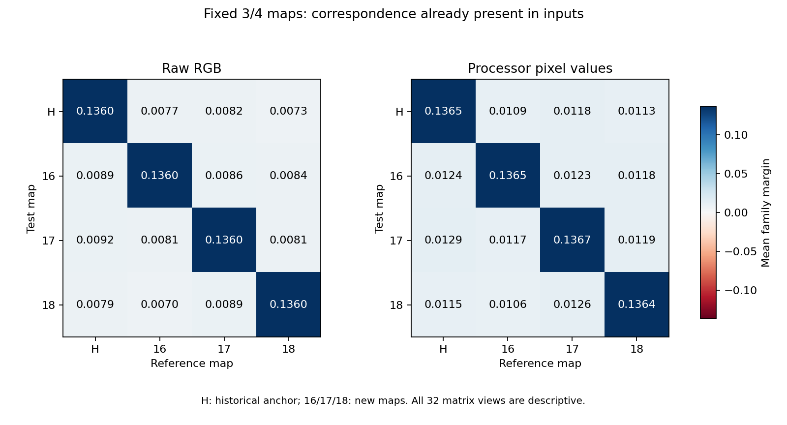
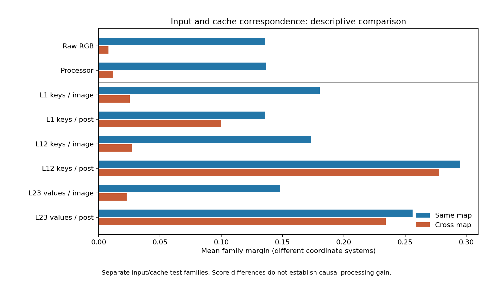

# Research Note 0050: Cross-Map Correspondence In Input Coordinates

Date: 2026-10-26

Status: measurement completed; independent publication verification passed.

## Main Result

Cross-map pairing correspondence is already detectable before a VLM forward.
Under the unchanged maps and source split from [Note 0049](0049_fixed_fraction_map_seed_transfer.md),
all four registered raw-RGB/processor-input aggregate tests pass their own
joint Holm correction. The cross-map mean margins retain **6.004%** of
same-map margins in raw RGB and **8.652%** in actual processor coordinates.
Their cross-map retrieval counts are only 6/16 and 4/16, respectively.

This changes the interpretation of the earlier cache result: the model is
not shown to create pairing correspondence from an input with none. Its
post-image L12/L23 margins are much less map-dependent in this descriptive
comparison, but score differences in different coordinate systems do not
identify causal processing gain, semantic extraction or mediation.

No new images, maps, model weights, model forwards or cache tensors were added.
All 512 saved canvases and regenerated processor tensors match their earlier
receipts. All eight negative primary family margins remain visible.

## Frozen Design And Coordinates

[Stage 4H](../pairing_validation_protocol.md#stage-4h-fixed-map-input-vector-baseline)
and the implementation were committed at `b1889b7` before computing these
input correspondence scores. This follow-up was selected after observing
the cache results; it is not an untouched confirmatory cohort.

- Four maps: historical 3/4 anchor and seeds 20261016, 20261017, 20261018.
- Thirty-two reused blocks: eight ordered pairing families x four source seeds.
- Four cells per block: MM, JJ, MJ, JM. The selected-site fraction remains 3/4.
- Raw view: the entire 320x320x3 RGB canvas, including palette-mean padding,
  converted to float64 and divided by 255.
- Processor view: the entire native `[1,3,1024,1024]` float32 `pixel_values`
  tensor, promoted to float64. No centering, whitening or dimensional reduction.
- Interaction: `jj - jm - mj + mm` in each coordinate system.

Processor identity, snapshot `81ffe929046666c43de53691147b1669ba0f3a4c`,
runtime and non-pixel input-audit payload remain unchanged. Each regenerated
pixel tensor matches both the input audit and the corresponding actual cache
capture's pixel hash. This is the qualified model-loading processor path,
not the native alternative that previously failed calibration.

The 512 cells yield 256 saved interaction vectors: four maps x 32 blocks x
two spaces. All 128 r1/r2 reference vectors are frozen before the r3/r4
vectors are materialized. Source images were nevertheless already observed
and used in earlier input-condition selection.

## Primary Correspondence

Reference directions are normalized sums of individually unit-normalized
r1/r2 vectors within each family; test vectors are r3/r4 only. A margin is
the own-family cosine minus the average cosine to the other three families
within the same broad class. Retrieval ranks all eight families instead.

Same-map scores average the three new-map diagonals; cross-map scores average
the six ordered new-map off-diagonals. Average cosines before computing
margins or retrieval. Historical-anchor comparisons remain descriptive.
Each regime has sixteen averaged test-seed rows, not 48 or 96 independent
samples. The same complete family-block assignment acts synchronously in
all maps, with all 576 within-class assignments enumerated.

| Input view | Regime | Mean margin | Retrieval /16 | Positive families /8 | Raw p | Holm p |
| --- | --- | ---: | ---: | ---: | ---: | ---: |
| Raw RGB | same | 0.136035 | 5 | 6 | 2/576 | 0.013889 |
| Raw RGB | cross | 0.008167 | 6 | 6 | 6/576 | 0.020833 |
| Processor pixels | same | 0.136509 | 5 | 6 | 3/576 | 0.015625 |
| Processor pixels | cross | 0.011811 | 4 | 6 | 7/576 | 0.020833 |

All four views are available, without retrieval ties. The four-test input
Holm family is separate from Note 0049's twelve cache tests. Passing a test
does not imply high retrieval or broad success across families. Raw retrieval
improves from 5/16 to 6/16 despite its much smaller cross-map margin; processor
retrieval decreases from 5/16 to 4/16. These are different statistics.

The eight negative primary family margins, out of 32 family-view summaries:

| Input view | Regime | Family | Margin |
| --- | --- | --- | ---: |
| Raw RGB | same | blue noise/random dots | -0.008919 |
| Raw RGB | same | white noise/random dots | -0.000325 |
| Raw RGB | cross | blue noise/random dots | -0.001480 |
| Raw RGB | cross | white/blue noise | -0.000043 |
| Processor pixels | same | blue noise/random dots | -0.008725 |
| Processor pixels | same | white noise/random dots | -0.000848 |
| Processor pixels | cross | blue noise/random dots | -0.001670 |
| Processor pixels | cross | white/blue noise | -0.000114 |

## Full Matrix And Isometry Check

All 32 descriptive map-matrix average margins are positive. Family margins
are negative in 63/256 matrix family-view summaries: 32/128 in raw RGB and
31/128 in processor coordinates. These are dependent views, not extra tests.



Raw same-map scores agree for a mathematical reason. If `P_m` is the same
pixel permutation applied to every factorial cell, including identity on the
padding, then `I_m = P_m I`. A common permutation preserves norms and inner
products, so it also preserves normalized family-reference scores when both
reference and test use that map.

All 96 inverse-permutation comparisons to the historical anchor are exactly
equal. The maximum raw diagonal-cosine difference is `2.22e-16` (rounded).
This checks implementation and coordinate consistency. It is not learned
invariance, three independent replications, or evidence that the correspondence
is semantic. Different-map scores need not obey this same-map identity.
The processor includes resampling and channel normalization; its coordinates
are not assumed to be an exact permutation of the raw ones.

## Input And Cache

The following is a descriptive comparison of cross-map mean margins divided
by same-map mean margins. Cache rows are unchanged observations from Note 0049.

| Coordinates | Cross/same mean margin |
| --- | ---: |
| Raw RGB | 6.004% |
| Processor pixels | 8.652% |
| L1 keys / image | 14.129% |
| L12 keys / image | 15.701% |
| L23 values / image | 15.502% |
| L1 keys / post-image | 73.432% |
| L12 keys / post-image | 94.147% |
| L23 values / post-image | 91.457% |



Thus the simple alternatives "only a shared map" and "correspondence first
appears in cache" are both too strong. These input vectors already have a
small cross-map signal under the registered aggregate score. Post-image
cache scores exhibit substantially greater cross/same ratios, but the assays
have different coordinates and separate tests. Neither the ratios nor their
differences measure retained semantic information or a causal amplification.

## Direction Is Still Different

All six unordered map pairs, 32 blocks and two spaces are retained as 384
dependent directional records, with reference/test phase identified. The
table pools only the three new/new map pairs: 96 dependent records per space.
Each column is a separately computed median, using the earlier-listed map
as the reference.

| Input view | Cosine | Norm ratio | Perpendicular share of delta energy |
| --- | ---: | ---: | ---: |
| Raw RGB | 0.062063 | 1.000000 | 0.531031 |
| Processor pixels | 0.085023 | 0.999926 | 0.542628 |

Equal raw norms are expected under coordinate permutation, while direction
changes substantially across maps. The perpendicular share refers to the
change vector's energy, not semantic variance or the original vector's energy.
Positive correspondence, high retrieval, equal length and vector identity
remain distinct observations.

## Next Bounded Question

The maps still leave some source coordinates coincident. Note 0049 reports
equal-destination fractions of 6.091%-6.255% over the six map pairs, including
positions left fixed by both maps. The new raw cross-map cosine median is
numerically close to that range, but closeness alone does not identify its
cause.

Before another cache experiment, decompose the raw reference/test dot products
into coincident-source-coordinate and noncoincident-coordinate contributions,
with the existing normalization held fixed. These additive contributions can
also be carried through the family margins without selecting favorable pairs.
That diagnostic is proposed, not measured here. Then separate selection-mask
changes from permutation-destination changes in a registered design. Neither
step should treat input/cache score differences as causal mediation.

## Verification And Reproduction

The publication verifier reloads the raw canvases, regenerates the native
processor pixels, and recomputes interactions with separate arithmetic: an
integer RGB oracle and reordered float64 processor sums. It also recomputes
the 4,096 matrix cosines, 512 aggregate cosines, four synchronized exact tests,
joint Holm correction, 384 directional decompositions, and 96 raw inverse
checks. Frozen sources, code and reference ledgers are hash-checked.
The independent raw interaction oracle differs by at most `4.45e-16`
(rounded upward); the processor interaction oracle has maximum error zero.
All 26 frozen measurement-code files match the registration commit. The full
local suite passes **326 tests**; the new tests cover pixel-contract drift,
zero-vector missingness, dependence counts, inverse permutations and corrupted
scores. All 22 published numeric table rows match the machine-readable results.

Artifacts: [summary](../../examples/research_notes/0050_map_seed_input_baseline/summary.json),
[512 cells](../../examples/research_notes/0050_map_seed_input_baseline/cells.jsonl),
[256 vector receipts](../../examples/research_notes/0050_map_seed_input_baseline/vectors.jsonl),
[384 directional records](../../examples/research_notes/0050_map_seed_input_baseline/directional_decompositions.jsonl).
Raw arrays remain in ignored `runs/`; tracked receipts do not reconstruct
missing local inputs or the processor snapshot.

From the repository root, with retained historical data and fresh output roots:

```bash
PYTHONPATH=src HF_HUB_OFFLINE=1 TRANSFORMERS_OFFLINE=1 \
OPENBLAS_NUM_THREADS=1 VECLIB_MAXIMUM_THREADS=1 \
python3 scripts/run_map_seed_input_baseline.py \
  --config configs/map_seed_input_baseline_fastvlm_v1.json \
  --input-summary runs/map_seed_input_fastvlm_v1/map_seed_input_summary.json \
  --published-input examples/research_notes/0049_map_seed_input/summary.json \
  --cache-root runs/map_seed_cache_fastvlm_v1 \
  --cache-publication examples/research_notes/0049_map_seed_cache/summary.json \
  --processor-snapshot /path/to/81ffe929046666c43de53691147b1669ba0f3a4c \
  --output-root runs/map_seed_input_baseline_fastvlm_v1_reproduction

PYTHONPATH=src HF_HUB_OFFLINE=1 TRANSFORMERS_OFFLINE=1 \
python3 scripts/summarize_map_seed_input_baseline.py \
  --run-root runs/map_seed_input_baseline_fastvlm_v1 \
  --output-root examples/research_notes/0050_map_seed_input_baseline_reexport
```

Both commands refuse existing output directories. New cache/source/direct-probe
counts are zero; the cumulative cache and direct-readout evidence counts are
unchanged from Note 0049. Local implementation tests, exact input reproduction,
statistical correspondence and causal claims are separate levels of evidence.
