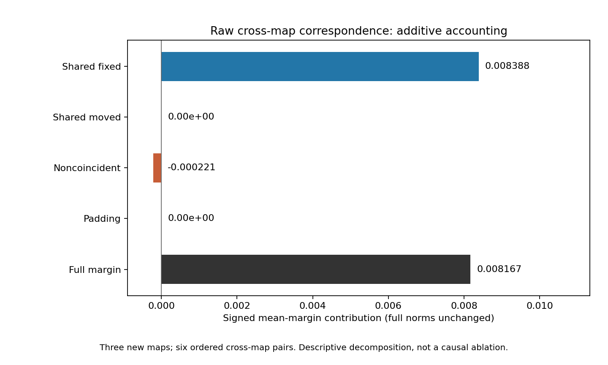
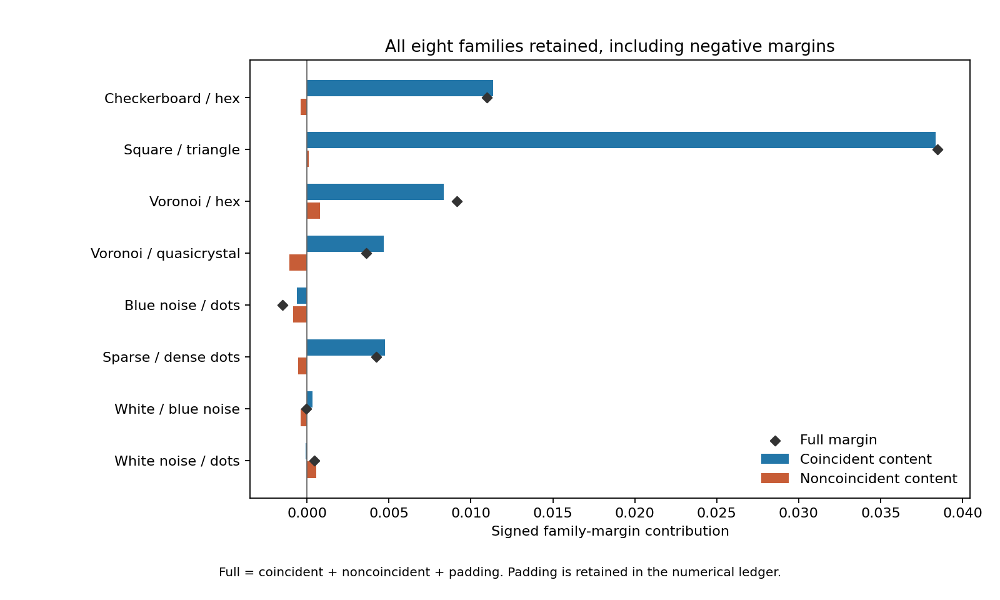

# Research Note 0051: Raw Correspondence And Shared Fixed Coordinates

Date: 2026-10-28

Status: decomposition completed; independent publication checks passed.

## Main Result

The positive raw cross-map aggregate from [Note 0050](0050_cross_map_correspondence_in_input_coordinates.md)
is accounted for by source coordinates that remained fixed in both maps.
With the original full-vector normalization unchanged:

```text
shared fixed contribution     +0.008387935536
noncoincident contribution    -0.000220742106
shared moved + padding         0
full cross-map mean margin    +0.008167193430
```

Thus shared fixed content contributes **102.703%** of the full mean margin,
and noncoincident content contributes **-2.703%**. These are signed score
ratios, not energy shares or causal percentages. A ratio above 100% is possible
because another term cancels part of the positive contribution.

This narrows the input-level result: the measured positive aggregate does
not require a positive aggregate contribution from noncoincident coordinates.
It does **not** establish that noncoincident coordinates are irrelevant in
every family. Their contribution is positive in 3/8 families, and two families
change sign relative to the coincident-only contribution, in opposite directions.
No processor, model, input-ablation or new statistical test was run.

## Registered Accounting

[Stage 4I](../pairing_validation_protocol.md#stage-4i-raw-source-coordinate-overlap-decomposition)
and the implementation were committed at `f208698` before this decomposition.
The four existing maps, 128 raw interaction vectors, eight families and r1/r2
reference versus r3/r4 split remain unchanged. All 16 ordered map pairs are
retained; aggregate same-map and cross-map results use only the three new maps.

A map records the original coordinate index `p(u)` that arrives at output
site `u`. Coincidence is equality of this source-coordinate index between
maps, **not equality of RGB values or identity of the source image**. The
reference and test images still belong to different source seeds.

Partition every canvas into four disjoint components:

1. Shared fixed content: `p_a(u) = p_b(u) = u`.
2. Shared moved content: `p_a(u) = p_b(u) != u`.
3. Noncoincident content: `p_a(u) != p_b(u)`.
4. Padding: outside the original content rows `[40,280)`.

Normalize each reference input, the sum of the two reference unit vectors,
and each test input using the same **full-vector norms** as Note 0050. Then
sum their elementwise products inside each component. There is no masked
renormalization. Component terms sum to the original cosine; the own-family
minus other-within-class-family margin is linear in these terms too.

The saved ledger contains 2,048 full dot products and 8,192 primitive additive
terms: 16 ordered map pairs x 16 test-seed rows x eight reference families.
All are available. This is accounting on dependent, reused inputs, not 2,048
new samples. Retrieval is nonlinear and is not decomposed into component
accuracies. Ratios with a denominator at or below `1e-12` in magnitude remain
null without dropping the associated scores.

## Which Coordinates Coincide?

In all six distinct map pairs, every coincident content coordinate is shared
fixed content. Shared moved coincidence is zero. Each canvas has another
25,600 padding pixels, kept separate from the 76,800-content-pixel denominator.

| Map pair | Shared fixed pixels | Shared moved pixels | Coincident content |
| --- | ---: | ---: | ---: |
| H / 20261016 | 4755 | 0 | 6.191406% |
| H / 20261017 | 4787 | 0 | 6.233073% |
| H / 20261018 | 4793 | 0 | 6.240885% |
| 20261016 / 20261017 | 4723 | 0 | 6.149740% |
| 20261016 / 20261018 | 4804 | 0 | 6.255208% |
| 20261017 / 20261018 | 4678 | 0 | 6.091146% |

H is the historical 3/4 map. These are observed coordinate counts, not counts
of independent coincidences or evidence for a population-level map law.
Selected-site fraction and actual moved-site fraction are still distinct.

## Aggregate Contributions

Each regime averages scores before family margins: three new-map diagonals
for same-map, six ordered new-map off-diagonals for cross-map. The original
sixteen averaged test-seed rows and eight equally weighted families remain.

| Component | Same-map mean margin | Cross-map mean margin | Cross-map fraction of full |
| --- | ---: | ---: | ---: |
| Shared fixed content | 0.034112342 | 0.008387936 | 102.703% |
| Shared moved content | 0.101922635 | 0.000000000 | 0.000% |
| Noncoincident content | 0.000000000 | -0.000220742 | -2.703% |
| Padding | 0.000000000 | 0.000000000 | 0.000% |
| Full margin | 0.136034977 | 0.008167193 | 100.000% |



All diagonal noncoincident terms are exactly zero, as required. Padding
contributes exactly zero to every saved dot product, not merely zero after
averaging. Shared moved terms are zero in all off-diagonal records, because
that component has no positions in these map pairs.

The full raw cosine scores reproduce Note 0050 with maximum difference zero;
mean-margin differences are at most `2.78e-17` (rounded upward). This is the
same correspondence statistic, now decomposed, not a new positive result.
The earlier four input tests and twelve cache tests retain their own existing
claim boundaries; no component p-values are added.

## Family-Level Counterexamples

All eight cross-map family margins are shown below. Shared moved and padding
contributions are zero, so coincident content equals shared fixed content.

| Family | Coincident contribution | Noncoincident contribution | Full margin |
| --- | ---: | ---: | ---: |
| Checkerboard / hex | 0.011343284 | -0.000383624 | 0.010959660 |
| Square / triangle | 0.038357454 | 0.000097215 | 0.038454669 |
| Voronoi / hex | 0.008359520 | 0.000791839 | 0.009151358 |
| Voronoi / quasicrystal | 0.004681232 | -0.001062994 | 0.003618238 |
| Blue noise / dots | -0.000618992 | -0.000860758 | -0.001479750 |
| Sparse / dense dots | 0.004741095 | -0.000529449 | 0.004211646 |
| White / blue noise | 0.000330846 | -0.000374306 | -0.000043460 |
| White noise / dots | -0.000090954 | 0.000556140 | 0.000465186 |



Noncoincident contributions are positive for square/triangle, Voronoi/hex,
and white noise/dots. In white/blue noise, they reverse a positive coincident
margin into a negative full margin. In white noise/dots, they reverse a
negative coincident margin into a positive full margin. Therefore "all useful
correspondence comes from fixed positions" is too strong at family level.

The same caution applies to map pairs. Among all twelve ordered off-diagonal
views, noncoincident mean margins are positive in five and negative in seven.
Among the six new/new views, they split three positive and three negative.
Coincident/full mean-margin ratios over all twelve range from 92.990% to
119.481%. The aggregate negative remainder is not a uniform pairwise effect.
All matrix records remain available in the summary.

## Interpretation And Next Control

The earlier approximately 6% raw margin ratio now has a concrete accounting:
in this aggregate, a small set of shared fixed coordinates supplies the
positive score, and the other coordinates slightly reduce it. This is more
specific than merely noting that overlap and cosine magnitudes are similar.
It remains an algebraic decomposition, not an intervention on the images.

Removing a term from a normalized dot product is not equivalent to erasing
pixels, changing permutation masks, re-normalizing a masked vector or
re-running the model. Nor can this raw partition be transferred directly to
resampled processor pixels or cache token coordinates. In particular, it does
not explain away Note 0049's post-image cache results or establish their cause.

The next bounded control should vary shared fixed-coordinate overlap
explicitly while keeping the selected fraction, expanded RGB marginals and
padding fixed. Selection masks and permutation destinations must be controlled
separately. Freeze the construction and seeds before scoring, count incidental
fixed points and actual source-coordinate coincidences, and pass the unchanged
all-cell processor gates before any cache comparison. Do not select maps by
their favorable correspondence scores. This new panel is proposed, not run.

## Verification And Reproduction

The independent verifier reloads all 512 raw cells and recomputes all 128
interactions using an integer RGB oracle. It constructs coordinate categories
with a separate sitewise implementation, computes full norms independently,
and uses per-pixel RGB dot products plus grouped summation to check all 8,192
terms. It also checks every full score, test-seed/family margin, signed ratio,
map weight and both aggregate regimes.

The maximum raw-interaction oracle error is `4.45e-16`; the maximum component
oracle error is `2.45e-13`, both rounded upward. The latter remains below the
unchanged `1e-12` verification tolerance. Original dot-product reconstruction
error is at most `1.78e-15`, test-seed margin reconstruction `1.89e-15`, and
family-margin reconstruction `5.56e-16`, rounded upward. No tolerances were
relaxed. Frozen source and code hashes accompany the publication.

All 363 repository tests pass. The 28 frozen measurement-code files and config
match both the registered commit and the live checkout. All 19 numeric table
rows above match the publication JSON; 260 local links and anchors in the
updated documentation resolve. Publication ledger, figure and exporter hashes
also match. These are implementation and artifact checks, not new observations.

Artifacts: [summary](../../examples/research_notes/0051_source_coordinate_overlap/summary.json),
[2,048 dot products](../../examples/research_notes/0051_source_coordinate_overlap/dot_products.jsonl),
[128 source-vector receipts](../../examples/research_notes/0051_source_coordinate_overlap/source_vectors.json).
Local raw vectors and source images remain in ignored `runs/` directories.
There are no new input vectors, processor calls or model forwards, and no
changes to cumulative cache or direct-probe counts.

From the repository root, using retained source artifacts and fresh output roots:

```bash
PYTHONPATH=src OPENBLAS_NUM_THREADS=1 VECLIB_MAXIMUM_THREADS=1 \
python3 scripts/run_source_coordinate_overlap.py \
  --config configs/source_coordinate_overlap_v1.json \
  --baseline-root runs/map_seed_input_baseline_fastvlm_v1 \
  --baseline-publication examples/research_notes/0050_map_seed_input_baseline \
  --output-root runs/source_coordinate_overlap_v1_reproduction

PYTHONPATH=src OPENBLAS_NUM_THREADS=1 VECLIB_MAXIMUM_THREADS=1 \
python3 scripts/summarize_source_coordinate_overlap.py \
  --run-root runs/source_coordinate_overlap_v1 \
  --output-root examples/research_notes/0051_source_coordinate_overlap_reexport
```

Both commands refuse existing output directories. The registered measurement
code must be committed before execution. Publication receipts alone do not
reconstruct missing raw inputs or arrays.
