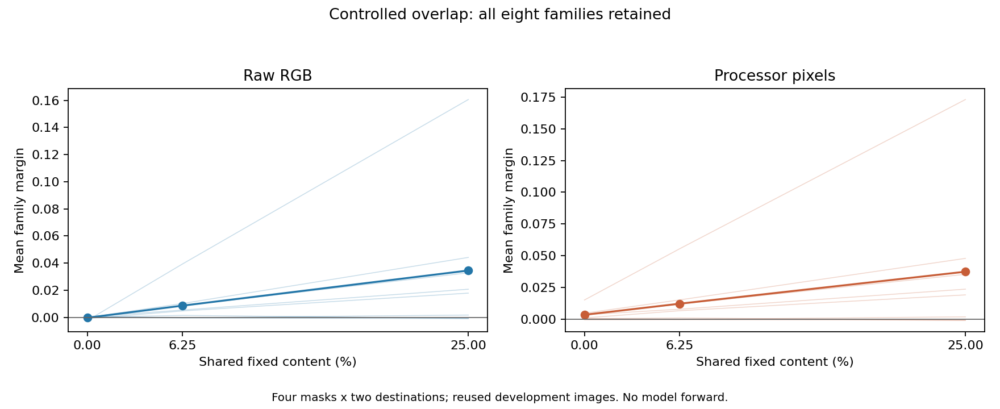
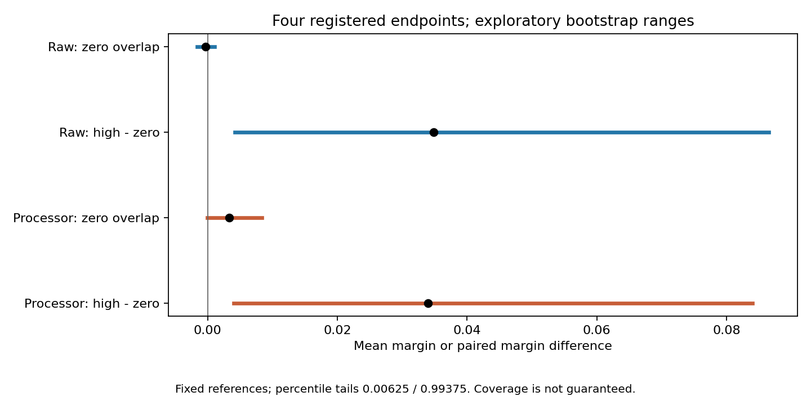

# Research Note 0056: Controlled Overlap Input Correspondence

Date: 2026-10-29

Status: Phase 1 completed; measurement, analysis and independent publication
verification passed. Phase 2 is not started.

## Main Result

Phase 1 has an input-level answer, not a cache mechanism. With exact zero
reference/test content-coordinate coincidence, the mean correspondence margin
is **-0.000315703 in raw RGB** and **+0.003352657 in processor pixels**. Raising
shared fixed content to 25% increases these means by **+0.034846370** and
**+0.033963924**, respectively. Both zero-overlap exploratory ranges include
zero; neither an absence claim nor a confirmed positive processor residual
follows. The positive high-minus-zero differences are heterogeneous across
families and remain development observations, not new significance claims.

All 28 maps qualify on all 32 input blocks in
[Note 0055](0055_controlled_overlap_input_qualification.md). All planned views
are available. No map, family, negative margin or failed endpoint was filtered.
No model forward, cache capture, p-value, equivalence test or confirmation
cohort is added. The four primary descriptive endpoints and analysis code
were fixed at `1e19014` before new image measurements.

## Registered Scores

Use the full interaction `JJ - JM - MJ + MM`, normalized over the complete
raw or actual-processor vector. Each family reference is the normalized sum
of separately normalized r1 and r2 interactions. A test margin is own-family
cosine minus the mean cosine with the other three families in its broad class.
Average scores over four masks x two destinations, then two test seeds within
each family, then all eight families equally. The 16 test rows are reused
sources, not 128 independent test images. References remain fixed.

| View | Shared fixed content | Mean family margin | Positive families | Own-family retrieval |
| --- | ---: | ---: | ---: | ---: |
| Raw RGB | 0% | -0.000315703 | 2/8 | 2/16 |
| Raw RGB | 6.25% | +0.008624608 | 6/8 | 5/16 |
| Raw RGB | 25% | +0.034530667 | 6/8 | 5/16 |
| Processor pixels | 0% | +0.003352657 | 7/8 | 7/16 |
| Processor pixels | 6.25% | +0.012091707 | 6/8 | 5/16 |
| Processor pixels | 25% | +0.037316581 | 6/8 | 5/16 |

Retrieval is over all eight references, whereas the margin compares the
other three within-class families. These are different summaries. In
particular, processor retrieval decreases despite the increasing average
margin; a larger margin is not universally improved identification.



## Four Primary Endpoints

The paired difference D is `M(1/4) - M(0)`. Pair source seeds, reference maps,
mask identities and destination-replicate identities across levels; this does
not keep moved destinations identical when the fixed set changes.

| View / endpoint | Mean | Exploratory lower | Exploratory upper | Width |
| --- | ---: | ---: | ---: | ---: |
| Raw M(0) | -0.000315703 | -0.001652601 | +0.001028480 | 0.002681080 |
| Raw D | +0.034846370 | +0.004228507 | +0.086522249 | 0.082293742 |
| Processor M(0) | +0.003352657 | -0.000069954 | +0.008368726 | 0.008438680 |
| Processor D | +0.033963924 | +0.004038887 | +0.084019539 | 0.079980651 |



These are the registered 10,000-draw crossed-block percentile ranges with
seed 2026102920 and quantiles 0.00625/0.99375. Family/mask blocks, destination
draws within masks and test seeds within families are resampled as specified
in [Note 0054](0054_controlled_overlap_phase1_registration.md), with the same
draws across levels/views and fixed references. The four-endpoint Bonferroni
tail allocation does not guarantee simultaneous coverage for this small,
reused development panel. Excluding zero for D is not promoted to a validated
test. No equivalence width or minimum detectable effect was guaranteed.
The widths, including the broad D ranges, are part of the result.

Across the four masks, raw M(0) ranges from -0.000606 to -0.000122; processor
M(0) ranges from +0.002782 to +0.003768. Raw D spans +0.034085 to +0.035574,
and processor D +0.033460 to +0.034990. Those four observations are not
independent family replications and do not replace the joint uncertainty audit.

## All Family Endpoints

| Family | Raw M(0) | Raw D | Processor M(0) | Processor D |
| --- | ---: | ---: | ---: | ---: |
| Checkerboard / hex | -0.000194403 | +0.044382292 | +0.004557961 | +0.043270529 |
| Square / triangle | -0.002298954 | +0.162953172 | +0.015018215 | +0.158068856 |
| Voronoi / hex | -0.000041809 | +0.032904554 | +0.003213624 | +0.032041421 |
| Voronoi / quasicrystal | +0.000356523 | +0.020371306 | +0.003381231 | +0.020177790 |
| Blue noise / dots | -0.000031638 | -0.000828198 | -0.000604626 | -0.000243405 |
| Sparse / dense dots | -0.000853415 | +0.018710225 | +0.000833381 | +0.018201721 |
| White / blue noise | +0.000553698 | +0.001127710 | +0.000234172 | +0.001498487 |
| White noise / dots | -0.000015622 | -0.000850100 | +0.000187299 | -0.001304009 |

D is positive in 6/8 families in each representation, not all eight. Blue
noise/dots and white noise/dots go in the opposite direction. Square/triangle
has a much larger D than the others. The geometry/stochastic contrast is
descriptive here; no new broad-class test or post-hoc family exclusion is made.

## Raw Accounting And Same-Map Controls

Keep full-vector normalization unchanged and partition raw score terms by
source-coordinate equality, not RGB equality. The mean-margin decomposition is:

| Shared fixed content | Shared-fixed term | Noncoincident term | Shared-moved / padding | Full margin |
| --- | ---: | ---: | ---: | ---: |
| 0% | 0 | -0.000315703 | 0 / 0 | -0.000315703 |
| 6.25% | +0.008481038 | +0.000143570 | 0 / 0 | +0.008624608 |
| 25% | +0.034205943 | +0.000324724 | 0 / 0 | +0.034530667 |

Thus most of the increasing raw aggregate is in shared-fixed terms. The
noncoincident aggregate is not identically zero and changes sign across
levels. This is accounting of a constructed input manipulation, not a pure
causal effect of overlap with every other spatial property held constant.
The raw coordinate partition cannot be assigned directly to resized processor
pixels or model tokens.

The four same-map raw controls all have mean margin 0.136034977 and retrieval
5/16. Their full-score spread is at most `1.43e-14` (rounded upward), consistent
with common-permutation isometry and floating-point accumulation. This is
an algebraic positive control, not learned invariance. Same-map processor
margins span 0.136043-0.136854 with retrieval 4-5/16. These controls are
separate from the 25%-overlap test maps.

## Phase 1 Decision

1. **Input construction and eligibility are complete.** The exact q = 0
   condition removes all content source-coordinate coincidence, including
   incidental moved coincidence, while retaining expanded marginals and
   the unchanged within-block gates.
2. **The descriptive raw result depends strongly on controlled overlap.**
   The positive aggregate is not uniform across families. Zero-overlap ranges
   do not prove absence, and modest between-level spectral drift remains.
3. **A processor-space residual remains a calibration question.** Zero
   coordinate coincidence does not force processor cosine or margin to zero.
   Resampling and spatial mixing are possible explanations to test in the
   later simple-processing baseline stage; this experiment does not isolate
   which operation accounts for the difference.
4. **Phase 2 is eligible, not executed.** Separately register calibrated
   FastVLM L1 keys / L12 keys / L23 values, preserving all masks, levels,
   families and paired source identities. Decide cache endpoints, controls,
   uncertainty and resource budget before the first cache outcome. A larger
   cache margin alone cannot establish learned or causal gain over inputs.

Stop here for Phase 1. The untouched FastVLM/Qwen confirmation cohort remains
not generated and not sealed. No results-dependent expansion, favorable-map
selection or change to the fixed development budget is made.

## Verification And Reproduction

The publisher checks every coordinate recipe, historical receipt, all 3,584
raw/processor cells, and all 1,024 saved interactions. It independently
recomputes 56 full score matrices (7,168 cosine entries), all 14,336 raw
component entries, every seed/family/aggregate summary, the paired margin
array and the 10,000 bootstrap draws. The shared RNG and spectral extractor
are explicit limits of implementation independence. Measurement sources and
the 30 qualified code files remain hash-locked.
Maximum interaction reconstruction error is `4.45e-16` and full-score
oracle error `6.71e-13` (rounded upward), within the unchanged `1e-12`
tolerance. All raw component entries pass that tolerance too; maximum
measurement-side raw reconstruction error is `2.09e-13`. All bootstrap
endpoints and the 512 between-level spectral audits reproduce.

All **400 repository tests pass**, including independent numerical fixtures,
corrupted-receipt rejection and checked-in ledger/aggregate regression checks.
Ruff and diff whitespace checks pass. All 30 measurement code files and the
config still match the pre-outcome `1e19014` bytes; the publication exporter
matches its recorded hash. The compact summary SHA-256 is
`2df1804d0820ea02c82e299f3dfb74276d2aca202598059489578cbc16483f1c`.

Measurement/analysis commands are in Note 0054. Publication verification uses:

```bash
PYTHONPATH=src HF_HUB_OFFLINE=1 TRANSFORMERS_OFFLINE=1 \
OPENBLAS_NUM_THREADS=1 VECLIB_MAXIMUM_THREADS=1 \
python3 scripts/summarize_controlled_overlap.py \
  --run-root runs/controlled_overlap_input_v1 \
  --output-root examples/research_notes/0056_controlled_overlap_phase1
```

All output roots must be fresh; existing measurements are not overwritten.
Public [summary](../../examples/research_notes/0056_controlled_overlap_phase1/summary.json),
[scores](../../examples/research_notes/0056_controlled_overlap_phase1/scores.jsonl),
[cell audits](../../examples/research_notes/0056_controlled_overlap_phase1/cells.jsonl),
[vector receipts](../../examples/research_notes/0056_controlled_overlap_phase1/vectors.jsonl)
and [spectral drift](../../examples/research_notes/0056_controlled_overlap_phase1/between_level_spectra.jsonl)
retain exact values, missingness, construction recipes and hashes.
