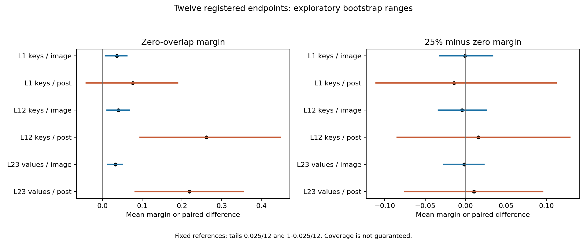
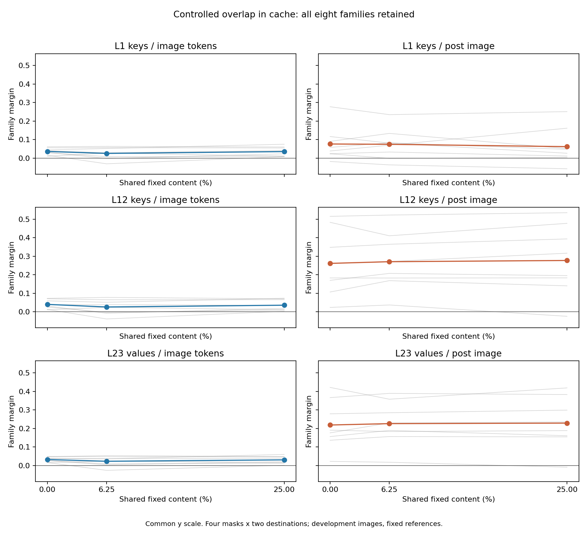

# Research Note 0060: Controlled Overlap Cache Correspondence

Date: 2026-10-29

Status: complete. Same-process calibration, all 2,048 experimental cells,
fixed analysis and independent publication verification passed. All twelve
registered endpoints are available. No confirmation cohort was generated.

## Main Result

Zero source-coordinate coincidence does not eliminate measured cache
correspondence in this development panel. Five of six zero-overlap ranges
lie above zero, including all three image-region views and post-image L12/L23.
But all six paired 25%-minus-zero ranges span zero. This is not an equivalence
result, a coordinate-independent mechanism or evidence of learned semantic
invariance. Similar aggregate margins also coexist with changed vector
directions and much larger image margins in the same-map controls.

[Note 0061](0061_controlled_overlap_phase2_decision.md) records the scope decision:
proceed to separately registered simple-processing baselines, not more overlap
seeds until a preferred result appears.

## Measurement Contract

[Note 0057](0057_controlled_overlap_cache_registration.md) registered the
design at `526950d`, before new overlap-cache outcomes.
[Note 0058](0058_controlled_overlap_cache_calibration.md) qualified historical
replay but did not release the panel. [Note 0059](0059_controlled_overlap_cache_panel_release.md)
then fixed and tested capture/analysis at
`3be6645a6fb72b12935cc5c3ad30edaf05df3296`.
The original config remains byte-identical. This is registered development on
reused images, not untouched confirmation.

The input qualification is unchanged from
[Notes 0055](0055_controlled_overlap_input_qualification.md) and
[0056](0056_controlled_overlap_input_correspondence.md): all 896 four-cell
blocks on 28 maps pass the frozen within-condition processor gates. Every map
has exactly 25% fixed content sites. A reference and test map share exactly
0%, 6.25% or 25% fixed content, with zero shared moved content. Palette-mean
padding, expanded RGB multisets and square metadata remain fixed.
Changing overlap also changes spatial arrangement and between-level spectra;
this is not a frequency-isolated manipulation. Coincidence concerns source
indices, not a guarantee that colors at noncoincident coordinates differ.

Four reference masks and two destination realizations per overlap level give
28 maps. A reference map is held common across levels and destinations. The
32 existing development sources comprise eight ordered generator-pairing
families, with r1/r2 references and r3/r4 tests. They are not new held-out
images for this study. The constrained single-cycle map construction is not
uniform sampling from all permutations.

## Calibration And Capture

The qualified model is `mlx-community/FastVLM-0.5B-bf16`, snapshot
`81ffe929046666c43de53691147b1669ba0f3a4c`, under MLX 0.31.1 / MLX-VLM 0.4.4.
Weights are local and execution is offline. One model instance is retained
through calibration and panel capture, but each cell starts a fresh source
context. No image-conditioned prompt cache is carried between cells.

First, all 128 historical source cells are repeated in the panel process.
All 384 selected tensor comparisons, actual prepared inputs, suffix IDs and
effective layouts must be exact before any experimental cell is captured.
This repeats, rather than substitutes, the prior Note 0058 calibration.

Next, the 256 reference-source cells are frozen before test-source capture.
The append-only journal and reference seal require total ordinal 384 at the
seal and first test ordinal 385. The 1,792 subsequent test cells include both
the reference-map diagonal controls and all 24 cross-map conditions.
The experimental budget is 2,048 cells / 6,144 tensors / 512 factorial blocks /
1,536 target analyses. Including this run's calibration gives 2,176 cells /
6,528 tensors. Calibration repeats are excluded from experimental totals.

The targets remain L1 keys, L12 keys and L23 values. Native bf16 tensors are
stored as float32, shape `[1, 2, 397, 64]`. The effective partition is pre-image
`[0,42)`, image `[42,298)` and post-image `[298,397)`. The registered source
suffix is actual `The image`, with generation-step IDs `[785,2168,2168]`, not
the requested `ACK`. This stage does not measure a forced-choice direct probe.
Unexpected suffixes, tokens, image metadata, layouts or nonfinite tensors stop
the run; there is no retry, resume, replacement or response coercion.

## Estimands And Verification

For every target and region, compute `z = JJ - JM - MJ + MM` in float64.
Normalize the complete selected region before cosine scoring. For each family,
the fixed reference is `unit(unit(z_r1) + unit(z_r2))`. The test margin is its
own-family cosine minus the mean of the three other references in the same
broad class. Average score matrices across four masks and two destinations,
then two test seeds, then eight equally weighted families. Do not average
vectors before normalization or count cells as independent samples.

The twelve primary endpoints are `M(0)` and `D = M(25%) - M(0)` for six
target/region views. The intermediate 6.25% condition, same-map controls,
retrieval, norms, direction cosines and localization remain secondary. At
25% overlap the fixed masks coincide but the moved destinations differ; it
is not the same-map diagonal.

Use the registered 10,000 paired crossed-block bootstrap draws, seed
2026102930, with references held fixed and percentile tails `0.025/12` and
`1-0.025/12`. These are exploratory ranges with no guaranteed coverage, not
validated confidence intervals or new p-values. No equivalence width was
registered, so a range spanning zero cannot establish absence. Missing a
required zero/high score withholds both endpoints for its view; no family or
map is silently dropped. Undefined directions stay unavailable.

The separate publisher reloads source tensors and recomputes factorial norms,
balanced energy shares, scalar argmax positions, all 3,072 complete-region
interaction vectors, 168 cosine matrices, paired margins, bootstrap ranges
and 1,536 cross-level direction records. It verifies source/snapshot/code
hashes and reference-before-test ordering. Publication adds no model forwards.
The measurement and primary-analysis implementation remains frozen.

## Twelve Primary Endpoints

All values are cosine margins or paired differences of margins. Ranges are
the registered exploratory percentile ranges, not significance tests.

| View | M(0) | Exploratory range | D: 25% minus zero | Exploratory range | Negative families M(0) / D |
| --- | ---: | --- | ---: | --- | --- |
| L1 keys, image | +0.036133 | [+0.007607, +0.061121] | -0.000651 | [-0.031765, +0.033389] | 0/8 / 5/8 |
| L1 keys, post-image | +0.076432 | [-0.040952, +0.189202] | -0.014364 | [-0.110821, +0.111839] | 1/8 / 7/8 |
| L12 keys, image | +0.040013 | [+0.011326, +0.067686] | -0.004419 | [-0.033528, +0.025808] | 0/8 / 6/8 |
| L12 keys, post-image | +0.261395 | [+0.094713, +0.446677] | +0.015731 | [-0.084516, +0.129089] | 0/8 / 2/8 |
| L23 values, image | +0.032027 | [+0.013586, +0.049765] | -0.001919 | [-0.026914, +0.022785] | 0/8 / 5/8 |
| L23 values, post-image | +0.218293 | [+0.082020, +0.354500] | +0.010274 | [-0.075110, +0.095436] | 0/8 / 3/8 |

All six M(0) means are positive, but L1 post-image is imprecise and retains a
negative white/blue-noise family margin (-0.018010). The other five views have
8/8 positive family margins. The overlap difference D is negative in 28/48
family-view entries, including white/blue noise at all six views. Across the
twelve endpoints, 29/96 family values are negative. No family is removed;
the summary contains all values and all four mask means for every endpoint.

The input comparison remains descriptive: raw/processor M(0) was
-0.000316 / +0.003353 and D was +0.034846 / +0.033964. The raw/processor and
cache profiles differ, but their coordinate systems and representations also
differ. No input/cache ratio, difference in interval exclusion, or subtraction
of these means identifies causal processing gain. In particular, zero exact
raw-coordinate coincidence need not remove common local statistics, nearby
receptive-field overlap or correspondence after resampling and pooling.



## Secondary Profiles And Exceptions

Each retrieval denominator is sixteen averaged test-seed rows, not cells or
map pairs. These diagnostics do not create an additional inferential family.

| View | M(0) / M(6.25%) / M(25%) | Retrieval at 0 / 6.25 / 25% | Negative families at 0 / 6.25 / 25% |
| --- | --- | --- | --- |
| L1 keys, image | .036133 / .025642 / .035482 | 14/16 / 9/16 / 12/16 | 0 / 2 / 0 |
| L1 keys, post-image | .076432 / .074813 / .062069 | 7/16 / 7/16 / 5/16 | 1 / 2 / 1 |
| L12 keys, image | .040013 / .025954 / .035595 | 13/16 / 8/16 / 10/16 | 0 / 3 / 0 |
| L12 keys, post-image | .261395 / .270498 / .277125 | 11/16 / 14/16 / 11/16 | 0 / 0 / 1 |
| L23 values, image | .032027 / .022463 / .030108 | 14/16 / 11/16 / 13/16 | 0 / 1 / 0 |
| L23 values, post-image | .218293 / .225726 / .228566 | 12/16 / 12/16 / 12/16 | 0 / 0 / 1 |

The intermediate image-region means are lower than both endpoints at all
three targets. Do not impose a monotonic dose-response story. At 25%, the
white/blue-noise family is negative at every post-image target. Across the
18 overlap aggregates, 12/144 family-view-level margins are negative.

Same-map image margins across the four reference masks range from
0.161770-0.177250 at L1, 0.154065-0.165100 at L12 and 0.136581-0.143473 at
L23. They are substantially higher descriptively than the cross-map 25%
means. The present zero-to-25% contrast therefore cannot establish absence
of map dependence or substitute for the same-map control.



For each view, the following are medians over 128 dependent, paired
mask/destination/test-source records comparing q=0 with q=25%. The other
768 q=0-to-6.25% records are also retained in the direction ledger.

| View | Direction cosine | Norm ratio | Relative L2 difference |
| --- | ---: | ---: | ---: |
| L1 keys, image | 0.078163 | 1.000897 | 1.355215 |
| L1 keys, post-image | 0.162529 | 1.032993 | 1.292778 |
| L12 keys, image | 0.080640 | 1.000767 | 1.357403 |
| L12 keys, post-image | 0.374942 | 1.017574 | 1.101830 |
| L23 values, image | 0.069439 | 0.999962 | 1.364299 |
| L23 values, post-image | 0.335876 | 1.017827 | 1.146374 |

Near-unit norm ratios do not imply direction preservation. A family reference
can retain discriminatory correspondence while individual interaction vectors
change markedly. No cross-layer vector alignment is computed.

## Localization And Count Boundaries

All 1,536 target factorials have exactly zero pre-image spatial, palette and
interaction effects. All 1,536 interaction argmaxes are in image tokens, and
all image-energy fractions exceed 0.9. Balanced spatial/palette/interaction
dominance is **894/642/0 in image regions**, versus **893/643/0 over the whole
effective tensor**. Directional correspondence is not interaction-axis dominance.
These targets, regions and factorial cells are dependent measurements.

All 2,048 panel responses are actual `The image`, with the required step IDs;
this is a checked source-protocol property, not a new semantic readout result.
There were no retries, replacement cells, unavailable primary endpoints or
new direct probes. This panel-process calibration adds 128 separate source
forwards / 384 tensor comparisons, distinct from Note 0058's earlier repeat.
Each calibration covers 19,513,344 scalar pairs with zero byte difference.

The cumulative executed experimental selected-cache surface becomes
**3,816 source cells / 11,304 tensors / 2,826 target analyses**. Of 2,814
partition-resolved analyses, all have zero pre-image effects and 2,808 have
image-token interaction maxima and image-energy fraction above 0.9. Earlier
repeated-anchor counts remain included; these are not independent stimuli.
The direct-probe surface remains 104 factorials / 416 cells / 1,664
full-vocabulary sidecars.

## Artifacts And Reproduction

- [Verified summary and frozen provenance](../../examples/research_notes/0060_controlled_overlap_cache_panel/summary.json)
- [2,048 experimental cell receipts](../../examples/research_notes/0060_controlled_overlap_cache_panel/cells.jsonl)
- [384 calibration comparisons](../../examples/research_notes/0060_controlled_overlap_cache_panel/calibration.jsonl)
- [1,536 factorial receipts](../../examples/research_notes/0060_controlled_overlap_cache_panel/factorials.jsonl)
- [3,072 vector receipts](../../examples/research_notes/0060_controlled_overlap_cache_panel/vectors.jsonl)
- [168 complete score matrices](../../examples/research_notes/0060_controlled_overlap_cache_panel/scores.jsonl)
- [1,536 direction diagnostics](../../examples/research_notes/0060_controlled_overlap_cache_panel/directions.jsonl)

Publication summary SHA-256:
`1bf4f0b5fb2f6bc62b2448fe031300a18969f37a10b8a77ae6bc5d909ec801f0`.
Frozen specification SHA-256:
`fc6e340ef9b0a770c86a2f6104a967f7ef8b0f0c7d56a679b3c91277cf7a1579`.
Independent interaction reconstruction has maximum absolute error zero;
the separately computed cosine matrices differ by at most `1.0103e-14`.
All paired margins and all 10,000-draw bootstrap ranges reproduce within
the fixed numerical verification tolerance. The 38 frozen measurement/config
files remain unchanged.

All **457 repository tests pass**, including separate input/suffix corruption,
missingness, bootstrap-oracle and portable publication-receipt checks. A
second publication run from the retained captures reproduces all **nine public
files byte-for-byte**, including both figures and the summary. Neither the
independent verification nor that reproduction adds a model forward.

The small public bundle contains numerical ledgers, hashes and figures.
Full source images, model weights, NPZ tensors and NPY interaction vectors
remain local; receipt availability alone is not a tensor replay. Verification
was a separate local implementation, not an independent external laboratory.

```bash
PYTHONPATH=src OPENBLAS_NUM_THREADS=1 VECLIB_MAXIMUM_THREADS=1 \
python3 scripts/summarize_controlled_overlap_cache_panel.py \
  --run-root runs/controlled_overlap_cache_panel_v1 \
  --output-root /tmp/controlled_overlap_cache_panel_verified_copy
```

Use a fresh publication directory and the retained full run artifacts. This
command performs no model forwards. The earlier launch commands in Note 0059
document the completed one-shot run; do not rerun it to replace these outcomes.
