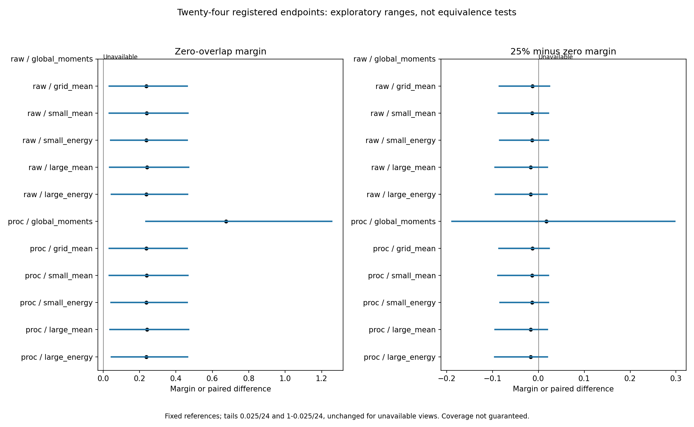
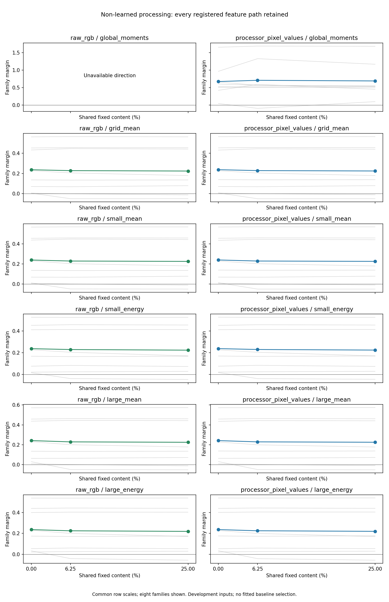

# Research Note 0065: Non-Learned Processing Correspondence

Date: 2026-11-03

Status: complete. All 2,048 feature cells, fixed analysis and independent
processor/feature regeneration passed. All 24 endpoints are retained: 22
available, with the two raw global-moment endpoints explicitly unavailable.

## Main Result

Non-learned processing already exhibits positive known-pairing correspondence
at zero exact source-coordinate coincidence. The simplest raw 8 x 8 mean
pool has M(0)=+0.236247; all eleven available views have exploratory ranges
above zero and 8/8 positive family margins. All eleven paired high-minus-zero
ranges span zero. This makes that coarse signature non-diagnostic of learned
cache processing; it does not show that a baseline reproduces the entire
cache geometry or passes an equivalence/sufficiency test.

[Note 0066](0066_nonlearned_baseline_decision.md) records the bounded reading
and the remaining representation-path gate. No new model forward was added.

## Design And Provenance

[Note 0062](0062_nonlearned_processing_registration.md) fixed six non-learned
paths on full raw RGB and native normalized processor starts. [Note 0063](0063_nonlearned_processing_calibration.md)
qualified their implementation without real-image baseline scoring.
[PR #4](https://github.com/RyoSpiralArchitect/fractal-vlm-state-probe/pull/4)
merged that stage at `10ae3de`. The separately committed
[Note 0064](0064_nonlearned_processing_panel_release.md) then released the
complete capture/analysis/publication implementation at `99fb45c`, after all
492 local tests passed. Fifty-one measurement/config files are frozen before
any new baseline feature score.

The original feature configuration remains byte-identical. The 32 sources,
eight ordered generator-pairing families, four mask replicas, two destination
realizations and 28 maps are reused development material. Each map fixes 25%
of its own content; reference/test coincidence is exactly 0%, 6.25% or 25%,
with no shared moved coincidences. Source-coordinate coincidence is not RGB
inequality, matched neighborhoods, equal spectra or a VLM receptive field.

The paths are global per-channel means/uncentered second moments, 8 x 8 grid
means, and small/large local box means with or without pointwise squaring
before the same grid pool. Raw widths 3/9 and processor widths 9/29 are fixed,
with full-canvas edge replication and no padding crop. Features are float64,
dimension 6 or 192, with no fitting, whitening or learned weights. Processor
values remain natively normalized rather than denormalized to raw RGB units.

Compute the feature on each of MM/JJ/MJ/JM first, then the registered paired
contrast `(JJ-MJ)-(JM-MM)`. Unit-normalize the complete feature interaction.
The family reference is `unit(unit(r1)+unit(r2))`; r3/r4 are test sources,
not new untouched images in this study. The margin subtracts the other three
family references within the same broad class. Average score matrices across
the four masks and two destinations, then two test seeds per family and eight
equal families. Never average feature vectors before the registered scoring.

## Execution And Verification Contract

The run repeats 84 synthetic feature/oracle checks and all 128 historical
processor cells before experimental features. Seal 256 reference-source
cell receipts before 1,792 test-source cells. Total ordinal at seal is 384;
first test ordinal is 385. The experimental budget is 2,048 cells / 24,576
feature arrays / 512 factorial blocks / 6,144 interaction vectors. Calibration
is counted separately, with 2,176 capture-stage processor calls in all.

The independent publisher first verifies source/code hashes, order, all saved
vectors, 336 score matrices, 36 overlap aggregates and 3,072 paired direction
records. Then a separate qualified processor repeats 128 historical cells
and regenerates all 2,048 experimental images. Native pixel hashes and every
non-pixel payload must match the original receipts. All 24,576 features are
recomputed with the separate convolution/explicit-slice oracle, at fixed
absolute tolerance 1e-10. Saved-feature interactions must reconstruct exactly;
cosines and bootstrap checks use 1e-12 tolerance. These are different checks,
not permission to replace small vectors with oracle values.

Thus capture and verification together have a fixed budget of 4,352 processor
calls and **zero learned-model forwards**. All raw global-moment interactions
must cancel exactly as an algebraic negative calibration. Undefined directions
remain unavailable; no family, map or feature path may be dropped.

There are 24 primary descriptive endpoints: M(0) and M(25%)-M(0) at twelve
views. Paired crossed-block bootstrap draws number 10,000, seed 2026110203,
with references held fixed and tails 0.025/24 and 1-0.025/24. The tail family
is not reduced for unavailable views. Ranges are exploratory without guaranteed
coverage, not significance, equivalence or baseline-sufficiency tests. The
intermediate level, same-map controls, family signs, norms and cross-level
directions remain secondary. No retry, resume or replacement is allowed.

## All Primary Endpoints

Ranges below are the registered exploratory percentile ranges. Negative-family
counts have denominator eight per available endpoint; unavailable directions
are not assigned zero signs or used to reduce the 24-endpoint tail allocation.

| Start / feature | M(0) | Range | D: 25% minus zero | Range | Negative families M(0) / D |
| --- | ---: | --- | ---: | --- | --- |
| raw / global_moments | unavailable | exact zero | unavailable | exact zero | unavailable |
| raw / grid_mean | +0.236247 | [+0.032912, +0.461364] | -0.012610 | [-0.085118, +0.024577] | 0/8 / 4/8 |
| raw / small_mean | +0.238562 | [+0.032917, +0.465376] | -0.013893 | [-0.087406, +0.021876] | 0/8 / 4/8 |
| raw / small_energy | +0.236790 | [+0.042223, +0.460820] | -0.013620 | [-0.083969, +0.021811] | 0/8 / 4/8 |
| raw / large_mean | +0.241677 | [+0.036032, +0.469914] | -0.016938 | [-0.094200, +0.019627] | 0/8 / 3/8 |
| raw / large_energy | +0.236164 | [+0.045043, +0.463826] | -0.016938 | [-0.093386, +0.019259] | 0/8 / 3/8 |
| processor / global_moments | +0.674669 | [+0.235653, +1.256374] | +0.017300 | [-0.187839, +0.297496] | 0/8 / 3/8 |
| processor / grid_mean | +0.236996 | [+0.034078, +0.462201] | -0.012783 | [-0.085893, +0.023399] | 0/8 / 4/8 |
| processor / small_mean | +0.238946 | [+0.034197, +0.465338] | -0.014004 | [-0.088397, +0.021747] | 0/8 / 4/8 |
| processor / small_energy | +0.237346 | [+0.043524, +0.461255] | -0.013476 | [-0.083549, +0.021680] | 0/8 / 4/8 |
| processor / large_mean | +0.241709 | [+0.036576, +0.470044] | -0.016607 | [-0.094469, +0.019350] | 0/8 / 3/8 |
| processor / large_energy | +0.236398 | [+0.045125, +0.464422] | -0.016681 | [-0.095007, +0.019862] | 0/8 / 2/8 |

All 88 available zero-overlap family margins are positive. In contrast, 38/88
family-level D values are negative; ten of eleven mean D values are negative.
No D range excludes zero. This does not establish absence of overlap effects,
equivalence across conditions or uniform family responses. The raw global
moment control is exactly zero in all 512 blocks, leaving both endpoints
unavailable rather than two negative or zero-performance results.

The ten local-feature views have M(0) between +0.236164 and +0.241709. These
are descriptive similarities, not equality tests. Processor global moments
have a larger normalized margin despite much smaller interaction norms;
normalized correspondence is not a physical displacement or effect amplitude.
Reference prototypes remain data-derived from the declared r1/r2 sources,
even though the feature transforms contain no learned weights or fitting.

## Secondary Profiles And Exceptions

Each retrieval denominator is sixteen test-seed rows after map averaging.
The margin uses within-class distractors; retrieval searches all eight
families. The two summaries should not be equated.

| Start / feature | M(0) / M(6.25%) / M(25%) | Retrieval 0 / 6.25 / 25% |
| --- | --- | --- |
| raw / global_moments | unavailable / unavailable / unavailable | unavailable |
| raw / grid_mean | .236247 / .227836 / .223637 | 9/16 / 8/16 / 9/16 |
| raw / small_mean | .238562 / .228420 / .224669 | 9/16 / 8/16 / 9/16 |
| raw / small_energy | .236790 / .228905 / .223170 | 8/16 / 7/16 / 7/16 |
| raw / large_mean | .241677 / .228918 / .224739 | 9/16 / 8/16 / 9/16 |
| raw / large_energy | .236164 / .224898 / .219226 | 8/16 / 7/16 / 8/16 |
| processor / global_moments | .674669 / .710285 / .691969 | 10/16 / 11/16 / 10/16 |
| processor / grid_mean | .236996 / .228156 / .224212 | 9/16 / 8/16 / 9/16 |
| processor / small_mean | .238946 / .228485 / .224942 | 9/16 / 8/16 / 9/16 |
| processor / small_energy | .237346 / .229350 / .223871 | 8/16 / 7/16 / 7/16 |
| processor / large_mean | .241709 / .229033 / .225102 | 9/16 / 8/16 / 9/16 |
| processor / large_energy | .236398 / .225199 / .219717 | 8/16 / 7/16 / 8/16 |

All ten local-feature mean profiles decrease across the three sampled q
levels; processor global moments instead have an intermediate peak. These
do not reproduce the image-cache intermediate dips from Note 0060. Across
the 36 retained aggregates, there are 29 negative family values among 264
available slots; the other 24 planned slots belong to unavailable raw moments.
Negative intermediate/high-overlap cases remain in the score ledger.

Raw grid-mean same-map margins range from .218492 to .266838 across the four
reference maps, not a dramatic increase over the q=0 mean. In Note 0060,
image-cache same-map margins were much larger than their zero-overlap means.
This is another reason not to call the baseline a full cache-profile match.

For q=0 to q=25%, each row below summarizes 128 dependent paired source/mask/
destination records. All 3,072 direction records, including the intermediate
comparison and undefined raw moments, are retained.

| Start / feature | Median direction cosine | Median norm ratio | Median relative L2 |
| --- | ---: | ---: | ---: |
| raw / global_moments | unavailable | unavailable | unavailable |
| raw / grid_mean | .893928 | 1.008776 | .460504 |
| raw / small_mean | .894433 | 1.007699 | .456500 |
| raw / small_energy | .911181 | 1.004615 | .423795 |
| raw / large_mean | .899406 | 1.004043 | .445552 |
| raw / large_energy | .920203 | 1.002086 | .399984 |
| processor / global_moments | .968481 | 1.017203 | .449361 |
| processor / grid_mean | .891698 | 1.009288 | .465086 |
| processor / small_mean | .891926 | 1.008941 | .461784 |
| processor / small_energy | .910624 | 1.004987 | .425010 |
| processor / large_mean | .897046 | 1.004114 | .450590 |
| processor / large_energy | .919084 | 1.002505 | .401723 |

The processor global-moment interaction norms span `1.5839e-5` to `2.0281e-3`.
Their minimum ratio to the registered tolerance-derived L2 scale is about
16,166. This is a numerical-sensitivity diagnostic, not a statistical noise
estimate or precision certificate. Small amplitudes and large unit-vector
margins coexist; no small-norm case was suppressed or rescued.

## Verification And Count Boundaries

Capture completed without retries, replacements or input mismatches. The
reference seal is at the required 384/385 boundary. Independent regeneration
reproduces all 128 historical and all 2,048 experimental native processor
hashes. All 24,576 feature/oracle pairs pass, with maximum absolute error
**1.5260e-13**. The 6,144 saved interactions reconstruct exactly; the maximum
independent score discrepancy is **1.6653e-15**. All paired margins, 10,000-draw
ranges and secondary directions verify at the fixed tolerances.

The actual processor budget is 2,176 capture calls plus 2,176 independent
verification calls: **4,352 calls**. Note 0063's earlier calibration is a
separate stage, not included again as an experimental observation. There are
no new original sources, learned-model forwards, direct probes or cache
tensors. Experimental selected-cache totals remain **3,816 cells / 11,304
tensors / 2,826 analyses**; direct totals remain **104 factorials / 416 cells /
1,664 full-vocabulary sidecars**. Baseline vectors are a separate input-derived
surface, not additions to the cache denominator.

Verification ran in `runs/nonlearned_processing_panel_verified_v1`. Live
progress and the export receipt remain there. Only the eleven completed
summary/ledger/archive/figure files were copied byte-for-byte to the example
bundle; no processor call or result recalculation was added by transport.
The frozen capture, analysis and publication implementation stayed unchanged.

## Artifacts

- [Summary and frozen provenance](../../examples/research_notes/0065_nonlearned_processing_panel/summary.json)
- [2,048 cell receipts](../../examples/research_notes/0065_nonlearned_processing_panel/cells.jsonl)
- [128 capture calibrations](../../examples/research_notes/0065_nonlearned_processing_panel/calibration.jsonl)
- [128 independent processor calibrations](../../examples/research_notes/0065_nonlearned_processing_panel/verification_calibration.jsonl)
- [2,048 regenerated feature checks](../../examples/research_notes/0065_nonlearned_processing_panel/feature_checks.jsonl)
- [6,144 vector receipts](../../examples/research_notes/0065_nonlearned_processing_panel/vectors.jsonl)
- [Portable complete interaction archive](../../examples/research_notes/0065_nonlearned_processing_panel/interaction_vectors.npz)
- [336 score matrices](../../examples/research_notes/0065_nonlearned_processing_panel/scores.jsonl)
- [3,072 direction diagnostics](../../examples/research_notes/0065_nonlearned_processing_panel/directions.jsonl)

Publication summary SHA-256:
`01420d73cb0f67920b794a0a28c0a167c379fe6c63954e8c57a65ad3070f3b85`.
Portable archive SHA-256:
`f4f7a910ecdd6fb202557650a55680e72323e78cfed0ecc84d4b9450ccf124d7`.
Frozen specification SHA-256:
`5c8ab20ad760449bd293440a2ebb3fbbe242e6fd2f124499ebe39d4569e3a346`.

Portable archive tests recompute the score matrices, margins, family values
and bootstrap without original images, processor calls or model weights.
Full feature reconstruction still needs the qualified source inventory and
processor; cell feature files and full pixel tensors are not in this bundle.
No learned-versus-unlearned attribution, semantic invariance, equivalence or
untouched confirmation is established by these descriptive comparisons.

All **494 repository tests pass**, including portable replay of all primary
scores, family/mask margins and the registered bootstrap, without processor
calls. Scoped Ruff and whitespace checks pass, and all 366 checked local
documentation links resolve. All 51 frozen code/config files are unchanged.
The eleven exported files match the successful local verification output
byte-for-byte; this transport check is not a second independent experiment.
