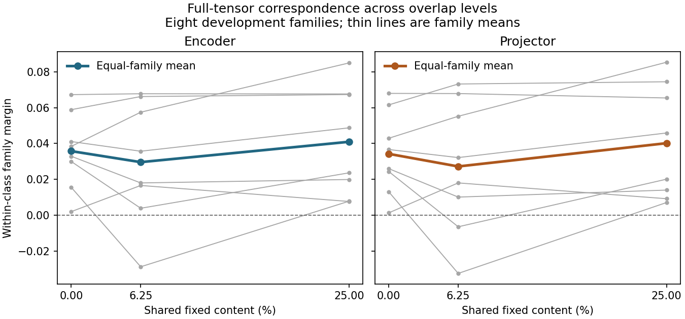

# Research Note 0070: Full Encoder/Projector Correspondence

Date: 2026-11-03

Status: COMPLETE. All four registered endpoints are available and independently
verified. All seven publication files reproduce byte-for-byte. Development
sources only; no new prompt control, p-value, equivalence test or confirmation.

At zero exact content-coordinate coincidence, the full encoder and projector
have positive family margins (+0.035765 and +0.034240), each positive in 8/8
families. Yet q=0 versus q=25% direction cosines have medians of only 0.086800
and 0.085254. Family correspondence without preservation of individual vector
direction is observable at both visual sites **before** language-model cache.

## Question And Evidence Units

For a fixed visual representation, do four-cell interaction directions
correspond across independent source replicates of the same known generator
pairing family when the reference/test maps share no exact content-coordinate
coincidences? How do margins and within-site directions change at 6.25% and
25% shared fixed sites? The score is a within-class family advantage, not a
semantic label, a cross-site vector alignment or a causal learning effect.

[Note 0069](0069_representation_correspondence_registration.md) fixed this
development panel before new model calls at
`996656c4263a716af3ac7e48eb84ae3c10c39371`. [PR #6](https://github.com/RyoSpiralArchitect/fractal-vlm-state-probe/pull/6)
had already merged the historical observation qualification into main at
`61b0e16a5f93fafd02d243288cb22ed4a2c48529` after light self-review and
525 local tests. No independent reviewer approval or CI result is claimed.
All 544 local tests passed for the new registration, including full-grid
fixtures, unavailable directions, injected failures and numerical replay.

The sites are the actual positional input to the FastVLM projector (encoder,
786,432 coordinates) and its actual return (projector, 229,376 coordinates).
Both include **all 256 positions and all channels**. The contrast is formed
at each site in float64 as `(JJ-MJ)-(JM-MM)`, then normalized in its own full
coordinate system. No pooling, fitting, cross-site alignment or learned
baseline selection. A source context is one fresh source replay, not a count
of internal autoregressive steps. The statistical units remain the eight
reused families, source replicates and crossed map replicates, not tokens,
scalar values or cache parity comparisons.

## Preflight And Calibration

The offline no-model preflight verified 2,048 accepted input/cache anchors
and 6,144 prior cache files against [Note 0060](0060_controlled_overlap_cache_correspondence.md).
The finite-word codec check covered all 65,280 finite bfloat16 words,
including signed zero; it also checked 256 saved historical site arrays.
The frozen inventory has 67 code/config files, 18,091 source hashes and
3,712 manifest hashes. It is provenance, not independent sample size.

Free space at preflight was 17,472,016,384 bytes against a fixed launch
requirement of 16,230,187,008, including an 8 GiB reserve. Experimental
NPZs store exact native words without ZIP compression; float64 vector
working files are re-derived in bounded groups. Nothing was deleted from
the previous experiments to pass the disk gate.

| Receipt | SHA-256 |
| --- | --- |
| Panel configuration | `b89423d12d079d7eed45746e24e26340e57d75c13e3051116c8aedb4fafe3b57` |
| Frozen specification | `dc6e3c855921a53092a8fff257b92a32e871184f37c8fba869eb3556c985aafd` |
| No-model preflight | `606c9e3442ab4568a618848ccd768f46af67cffa7119863d80265f971ff642ec` |
| Fresh calibration publication | `612b807544c2f67a865a2eaaf1d59c8589eb521ef09e14909d409b701d3cbc91` |
| Cross-run representation parity | `ae772f4390fc7911a960707989038a18a5070c3602f9741ed556c62545e5eab1` |

The unmodified calibration ran all 128 historical cells OFF/ON/OFF in
384 fresh contexts. All 1,152 historical cache pairs and 768 direct ON/OFF
pairs passed independent reload. All 256 fresh representation arrays also
matched the corresponding original [Note 0068](0068_representation_observation_calibration.md)
arrays byte-for-byte. The panel retained the **same single model and processor
objects**; no second load or alternate inference path. These 384 calibration
contexts are separate from the experimental acquisition.

## Complete Acquisition

All 256 r1/r2 reference-cell receipts were sealed after total ordinal 640.
The first r3/r4 test cell was 641; 1,792 test cells followed. All four masks,
28 maps, eight families and planned same-map controls are retained. Reference
and test source IDs are disjoint; the same test IDs recur across levels.
There were no replacements, model retries or resumes.

| Unit | Observed |
| --- | ---: |
| Calibration / experimental source contexts | 384 / 2,048 |
| Total fresh source contexts | 2,432 |
| Complete experimental site arrays | 4,096 |
| Four-cell blocks / full float64 interactions | 512 / 1,024 |
| Cosine matrices, including same-map controls | 56, including 8 controls |
| Cross-level direction records | 512 |
| Independent Note 0060 parity comparisons | 6,144 tensor pairs / 312,213,504 scalar pairs |

Every experimental prepared-input fingerprint, frame, prompt, actual suffix
(`The image`; step IDs `[785,2168,2168]`), layout and selected cache tensor
matched the corresponding Note 0060 map/source/cell. L1 keys, L12 keys and
L23 values are byte-identical over all positions. This extends measured
instrumentation parity to the panel inputs; it does not qualify every hidden
activation, a different runtime or a new prompt. No full-vocabulary direct
probe was run.

## Four Primary Endpoints

`M(0)` is own-family cosine minus the mean of the other three within-class
family cosines at zero overlap. `D = M(25%) - M(0)` is paired across masks,
destinations and test sources. Ranges below use the fixed 10,000-draw crossed
bootstrap, seed 2026110301, fixed references and four-endpoint tails of
0.00625 and 0.99375. They are exploratory, not calibrated confidence
intervals. Numbers in tables are rounded; ledgers retain full precision.

| Site | M(0) | Exploratory range | D | Exploratory range | Negative families: M(0), D |
| --- | ---: | --- | ---: | --- | --- |
| encoder | +0.035765 | [+0.012012, +0.059544] | +0.005206 | [-0.024275, +0.034342] | 0/8, 3/8 |
| projector | +0.034240 | [+0.009950, +0.059792] | +0.005953 | [-0.024159, +0.035666] | 0/8, 4/8 |

Both M(0) ranges lie above zero. Both D means are slightly positive but their
ranges span zero, and **7/16** site-family differences are negative. Three
mask-specific D means are positive at each site; the fourth is negative at
both (encoder -0.007871, projector -0.007430). These observations establish
neither an absence of overlap sensitivity nor equivalence of the sites.

| Ordered pairing family | Encoder M(0) | Encoder D | Projector M(0) | Projector D |
| --- | ---: | ---: | ---: | ---: |
| `geometry_checkerboard_hex_tiling` | +0.067260 | +0.000363 | +0.067949 | -0.002555 |
| `geometry_square_triangle_tiling` | +0.038400 | +0.046530 | +0.042937 | +0.042382 |
| `geometry_voronoi_hex_tiling` | +0.041102 | +0.007647 | +0.036656 | +0.009225 |
| `geometry_voronoi_quasicrystal` | +0.058872 | +0.008442 | +0.061543 | +0.012893 |
| `stochastic_blue_random_dots` | +0.032904 | -0.012963 | +0.025998 | -0.011952 |
| `stochastic_sparse_dense_dots` | +0.002039 | +0.005660 | +0.001358 | +0.007875 |
| `stochastic_white_blue_noise` | +0.015564 | -0.007714 | +0.013092 | -0.005980 |
| `stochastic_white_random_dots` | +0.029979 | -0.006316 | +0.024390 | -0.004266 |

Square/triangle tiling has the largest positive D at both sites. The three
negative encoder D families also have negative projector D; checkerboard/hex
changes from slightly positive to negative. Sparse/dense dots has a positive
but small M(0) at both sites. None is dropped or turned into another endpoint.

## Profiles And Directions

| Site | Shared fixed content | Mean family margin | Retrieval | Negative families |
| --- | ---: | ---: | ---: | ---: |
| encoder | 0% | +0.035765 | 12/16 | 0/8 |
| encoder | 6.25% | +0.029621 | 11/16 | 1/8 |
| encoder | 25% | +0.040971 | 12/16 | 0/8 |
| projector | 0% | +0.034240 | 11/16 | 0/8 |
| projector | 6.25% | +0.027219 | 10/16 | 2/8 |
| projector | 25% | +0.040193 | 12/16 | 0/8 |

Both sites dip at 6.25%, then rise above the q=0 mean at 25%. There are three
negative family margins among the 48 site/family/overlap aggregates, all
at 6.25%: white/blue noise at both sites and white/random dots at the
projector. Retrieval compares **all eight** references, not just the other
three within-class families used by the margin. There are no aggregate
retrieval ties.

Thin lines are family means, not uncertainty intervals. Across the four
same-map controls, mean margins span 0.152601-0.171903 at the encoder and
0.158393-0.178362 at the projector, much larger than the cross-map 25%
means. The diagonal is not the 25% condition: moved destinations still
differ at 25%. The four per-mask retrieval counts are 8/9/10/9 of 16 and
8/8/10/9 of 16, respectively; those are not the eight-map-averaged primary
score matrices.

The following are medians over 128 dependent test-source/mask/destination
records per row, comparing the two maps **within** one site. All are available.

| Site | Change in shared content | Direction cosine | Norm ratio | Relative L2 change |
| --- | --- | ---: | ---: | ---: |
| encoder | 0 to 6.25% | 0.123851 | 1.006770 | 1.325849 |
| encoder | 0 to 25% | 0.086800 | 1.001573 | 1.348714 |
| projector | 0 to 6.25% | 0.125372 | 1.006450 | 1.325380 |
| projector | 0 to 25% | 0.085254 | 1.003535 | 1.352881 |

Norm ratios remain close to one while directions change markedly. No full
interaction is zero: encoder norms range from 115.743 to 192.387, projector
norms from 54.945 to 92.738. Raw norms from different feature
spaces are not a common amplitude scale; no encoder-to-projector vector
cosine was calculated.

## Reading Across Representations

1. Full input vectors in [Note 0056](0056_controlled_overlap_input_correspondence.md)
   had near-zero aggregate M(0) (-0.000316 raw, +0.003353 processor) and
   larger positive D means (about +0.034). This does not isolate a pure
   coordinate-overlap effect: between-level spectral differences remain.
2. Non-learned raw 8 x 8 means in [Note 0065](0065_nonlearned_processing_correspondence.md)
   already gave M(0)=+0.236247. The ten local baselines decreased across q
   and their q=0-to-25% direction cosine medians were 0.892-0.920. Positive
   M(0) alone is not specific to learning. The raw global-moment directions
   remain unavailable; the comparison does not pick a baseline winner.
3. The actual visual sites share an intermediate dip and low cross-level
   directional persistence with the three image-cache views (M(0)=0.032-0.040,
   q=0-to-25% cosine medians 0.069-0.081). These profile features therefore
   need not first appear in language-model cache. They are **not identical
   profiles**: visual D means are positive, whereas all three image-cache D
   means are slightly negative. Every one of those D ranges spans zero.
4. Post-image L12 keys and L23 values have larger M(0) means (+0.261395 and
   +0.218293). Neither a larger score nor a similar score establishes gain,
   mediation or equality. Each of the four cells traverses the actual
   projector before the contrast is formed. Coordinates, normalization,
   context and range allocations differ across representations; no registered
   between-representation or trained-versus-untrained test was performed.

All four input, 24 non-learned and twelve selected-cache primary endpoints
are included as **context** in the summary, not as new independent tests.
This adds 2,048 experimental representation acquisitions. The 6,144 selected
cache replays are path checks on already measured conditions, not another
cache correspondence sample. The earlier core cache totals remain 3,816
experimental cells / 11,304 tensors / 2,826 target analyses; direct totals
remain 104 factorials / 416 cells / 1,664 full-vocabulary sidecars.

## Verification And Artifacts

The verifier re-expanded 4,096 full word arrays using an independent
half-word decoder, checked captured float32 hashes and reconstructed all
1,024 full contrast vectors byte-for-byte. Independent scalar products
reproduced every cosine in all 56 matrices (7,168 entries), all margins,
retrieval, family signs, 512 directions and all four bootstrap ranges.
Maximum absolute score discrepancy was `3.631e-14` (rounded upward), below
the frozen `1e-12` tolerance. Cache and full-vector comparisons use exact
bytes, not this tolerance. A second fresh-directory verification produced
the same seven public files byte-for-byte. Neither verification ran a model
or processor. The summary's analysis-stage `new_model_forwards: 0` is not
the acquisition count; `capture_summary.new_source_contexts` is 2,432.

- [Summary, provenance and comparison context](../../examples/research_notes/0070_representation_correspondence/summary.json)
- [2,048 cell and native-site receipts](../../examples/research_notes/0070_representation_correspondence/cells.jsonl)
- [Per-cell selected-cache parity](../../examples/research_notes/0070_representation_correspondence/cache_parity.jsonl)
- [1,024 full-vector digests and norms](../../examples/research_notes/0070_representation_correspondence/vectors.jsonl)
- [56 complete score matrices](../../examples/research_notes/0070_representation_correspondence/scores.jsonl)
- [512 cross-level direction records](../../examples/research_notes/0070_representation_correspondence/directions.jsonl)

Publication SHA-256:
`40327bc266271e300b436cd8d1125a81222d209fe1bef37c464bbecf93d500a4`.
Capture summary: `bf92af4cdd7fbdaac2da0bb41ea2511e8cf3dca7353045f0ef94e10576e46d25`.
Reference-cell seal digest: `de29fc8de20df2edc2f382e7a847ba790a488a577e35d8f249947f43200022c8`.
See Note 0069 for commands. Primary summaries/ranges can be replayed from
the public score matrices without model weights or research images. Full
activation/contrast reconstruction requires the local packed source cells
under `runs/representation_panel_v1`; the complete native tensors are not
distributed, and numerical verification is not a second model implementation.

All **546 local repository tests pass**. Public-only checks reproduce the
reference-cell seal, all primary point estimates and 10,000-draw ranges
from the score matrices, and check direction/norm consistency. All 67
frozen code/config hashes remain unchanged. Scoped Ruff, whitespace checks
and 397 local links in the updated documentation pass. These are local
checks, not CI or an independent reviewer approval.

## Next Boundary

Separately register the planned prompt/suffix/readout controls. A useful
first gate is same-image, identical prepared pixels and visual-site bytes
under a prompt-only change, with actual token IDs and layouts recorded.
Any teacher-forced suffix path needs its own parity calibration before use.
Keep source-cache and full-vocabulary direct probes as separate fresh
forwards. No such control or intervention was executed here, and the
untouched source/map confirmation cohort remains neither generated nor sealed.
