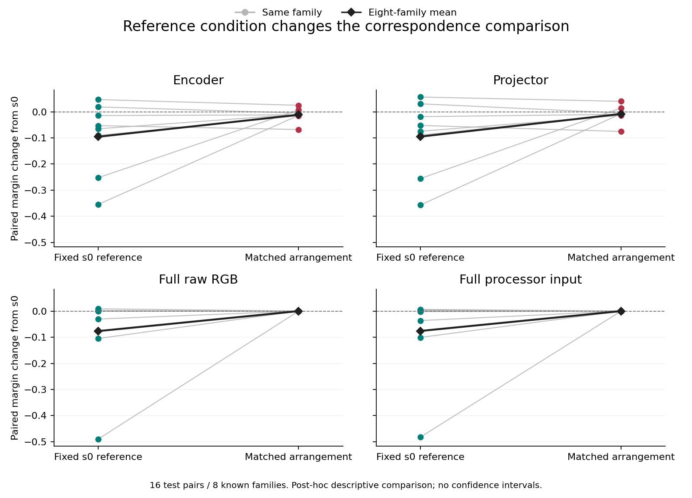

# Research Note 0098: Reference Condition Dependence And Full Input Comparators

2026-11-09. One saved-array run at committed implementation
`158afa56f8fde01320c23fe867dda7bb8b934da4` completed under the separate
[Note 0097 release](0097_reference_crossing_execution.md), without retry or
code change. Both fresh independent native-content verifications returned
`VERIFIED_NATIVE_CROSSINGS`; their complete output trees are byte-identical.
The [Note 0096 plan](0096_reference_crossing_registration.md) remains unchanged.
This is post-hoc relative to Note 0093, not untouched confirmation.

## Primary Descriptive Comparison

All endpoints retain 16/16 test pairs in all eight known families. All four
views and all three amplitude floors are present; endpoint values are
identical across floors. Reference/test arrangement crossings are all 4 x 4,
not a selected best reference. The primary floor is 1e-6.

| Full view | Fixed-s0 reference change | Matched-reference change | Reference difference |
| --- | ---: | ---: | ---: |
| Encoder | -0.095657 | -0.011530 | +0.084128 |
| Projector | -0.095054 | -0.008381 | +0.086674 |
| Raw RGB | -0.076563 | -2.639e-18 | +0.076563 |
| Processor input | -0.075960 | -6.966e-18 | +0.075960 |

Fixed change is mean m[0,b] minus m[0,0]; matched change is mean m[b,b]
minus m[0,0], over b=1/2/3. Their difference is the separately retained
reference_difference, not a causal recovery percentage. The exact encoder
matched change is **-0.011529552302370924**, and projector matched change is
**-0.008380542676332023**. The original fixed-s0 values reproduce Note 0093.

The mean negative change is much smaller when reference and test share the
arrangement. Full raw/native input vectors also have negative fixed-reference
changes, despite the twelve inherited summary-feature views remaining matched.
Thus the original fixed-reference decline is not exclusive to model sites.
At full input starts, matched-reference changes are on the numerical scale:
maximum absolute test-pair change is 1.1102230246251565e-16 for raw RGB and
8.326672684688674e-17 for native processor input. This is a descriptive
numerical observation, not a registered statistical equivalence result.

## All Families And Exceptions

| Known pairing family | Encoder fixed | Encoder matched | Projector fixed | Projector matched |
| --- | ---: | ---: | ---: | ---: |
| Voronoi / quasicrystal | -0.065158 | -0.010092 | -0.074642 | -0.014041 |
| Checkerboard / hex | -0.354761 | -0.013854 | -0.356681 | -0.007558 |
| Square / triangle | -0.252540 | +0.006942 | -0.255467 | +0.014295 |
| Voronoi / hex | -0.090559 | -0.015175 | -0.089357 | -0.009559 |
| White / blue noise | -0.052967 | -0.067953 | -0.052408 | -0.075351 |
| White noise / random dots | +0.018599 | -0.004982 | +0.030406 | -0.004836 |
| Blue noise / random dots | -0.014497 | -0.011800 | -0.018708 | -0.009854 |
| Sparse / dense dots | +0.046626 | +0.024676 | +0.056425 | +0.039858 |

This is not uniform recovery. White/blue noise becomes more negative under
matched references at both visual sites. Square/triangle changes sign from
negative to positive, while white-noise/random-dots changes from positive
to negative. Both visual sites still have six negative and two positive
matched family changes, but the membership differs from the fixed-reference
case. No family is removed, replaced or used to choose a new map.

Thin lines connect the same family; black diamonds show the equal-family
mean. The two reference conditions use the same test arrays. Points, floors,
arrangements and sites are not independent replicates. The full input panels
have overlapping matched points near zero; their identities and exact
values remain in the complete score profiles.

## Verification And Portable Artifacts

The production run checks native file and word hashes for all 2,048 selected
arrays and their fixed layouts, including expanded bfloat16 hashes at the
two visual sites. Both independent verifications reconstruct from those
original arrays rather than production interaction vectors. Maximum absolute
production/oracle difference across compared metadata and scores is
**3.219646771412954e-15**, below 1e-12. Pair-level endpoint closure residuals
are at most 8.326672684688674e-17; family and aggregate closure checks pass.
All original six learned s0 rows, margins, missingness, D and available
counts reproduce. All 135 inherited implementation files remain unchanged.

Public artifacts retain [all twelve profiles](../../examples/research_notes/0098_reference_crossing_results/profiles.jsonl),
[summary](../../examples/research_notes/0098_reference_crossing_results/summary.json),
[oracle checks](../../examples/research_notes/0098_reference_crossing_results/oracle_checks.jsonl),
[execution summary](../../examples/research_notes/0098_reference_crossing_results/execution_summary.json)
and [both verification receipts](../../examples/research_notes/0098_reference_crossing_results/verification_receipts.json).
The profile SHA256 is
`1423cb24a2e9d3fb70bf9b85b9f08f797e1b47d3ef3aedbedf23f2e222d6443b`.
Portable scores permit aggregate/missingness replay, not full native-word
reverification without the local capture. Norm-library arithmetic is shared;
native loading, expansion, score reductions and aggregation are independently
implemented as disclosed in Note 0097. No inference is independently rerun.

New sources, processor calls and model contexts are all zero. The one run
and two canonical verifications are consumed; an unexpected subsequent issue
must not be addressed by overwriting or retrying them.

## Reading For The Manuscript

The supported reading is **reference-condition-dependent correspondence,
with a residual visual-site change under matched references that is not
mirrored by the full input matched-reference margins in this cohort**.
The original twelve-feature separation remains true, but cannot support a
model-exclusive fixed-reference effect. The new input comparators prevent
that stronger interpretation.

Smaller average change does not establish a common orthogonal rotation,
preserved semantics, or the absence of information loss under every decoder.
The remaining visual changes do not by themselves identify training,
learning-specific processing, causal gain or cache-to-answer mediation.
There are no p-values, confidence intervals or equivalence tests. These
sixteen test pairs in eight known families remain development data. A fresh
source/map confirmation still needs its own frozen precision and stopping
policy before acquisition. No additional cohort is launched here.

The twelve-view gates do not constrain every input statistic; the descriptive
spectra retained in Note 0093 remain free to vary. No frequency-only or
spectral-causation claim follows from this crossing.

## Review Boundary

Separate read-only review cleared the corrected execution lifecycle before
scoring, then checked the public artifacts, receipts, publisher, figure and
manuscript/result claims. No actionable findings remained in the result
review. This is review of code and saved evidence, not another native
recomputation or independent model inference. Public-score and figure-hash
tests replay without the local native payloads.
